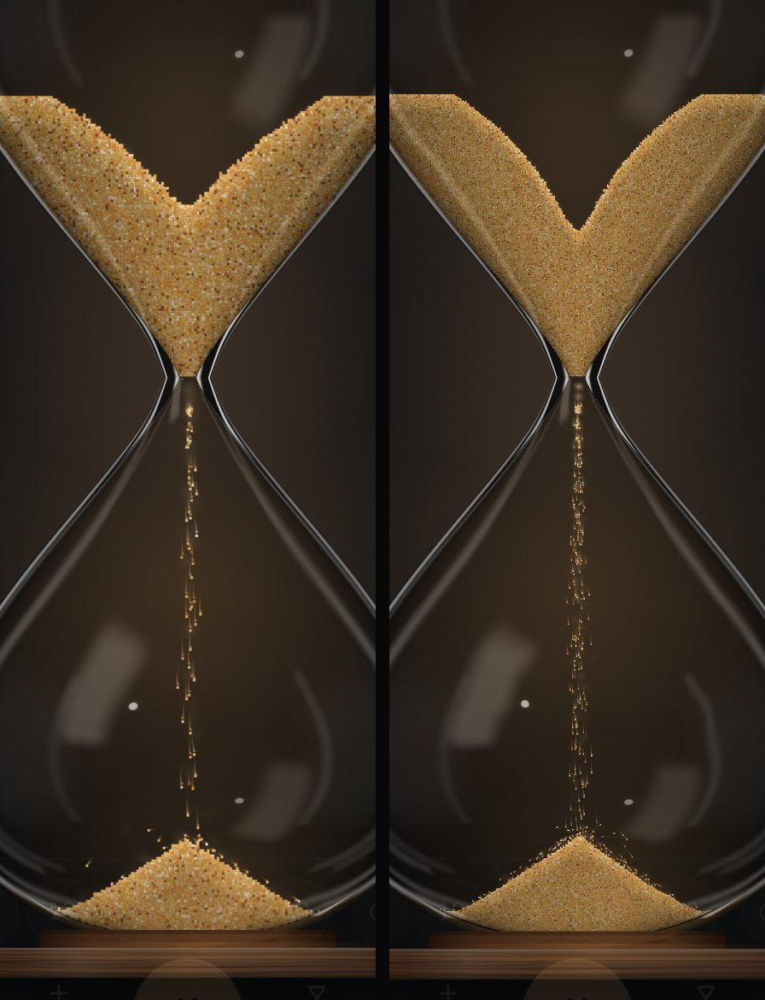
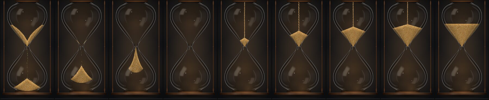

# Hourglass

*A calm sand timer you can hold.* Every grain is simulated and every sound is
synthesised as you listen. Turn the glass, flick it into a spin, tilt or shake
your phone, and the sand answers. Drop the glass, knock on it, spin it hard or
shake the phone hard and it creaks, then cracks; hold a finger on the crack
and it mends with gold.


**[Open Hourglass →](https://elkhanany.github.io/hourglass/)**

It is free, has no ads, accounts or tracking, and works offline. Nothing is
loaded from anywhere else: no libraries, no fonts, no audio files.

## Install it

- **iPhone and iPad (Safari):** open the link, tap **Share**, then **Add to
  Home Screen**. Opened from there it runs full screen and offline. To tilt
  and shake the sand with the phone, turn on **Real motion** in **Tune** and
  allow motion access when asked.
- **Android (Chrome):** open the link and tap **Install app** (or ⋮ →
  **Install app**). The installed app runs full screen; a long press on its
  icon offers 5, 15 and 30 minute glasses.
- **Desktop (Chrome, Edge, Safari):** it runs in the browser; Chrome and Edge
  also offer **Install** in the address bar. A burst of mouse clicks knocks
  on the glass.

## Six sands


Sahara Quartz in walnut, Volcanic Black in brushed brass, Moonstone in
frosted silver, Lapis Lazuli in gold, Rose Quartz in copper and Sea Glass in
driftwood. Tap the name at the top to change it, or choose in **Tune**. With
**Layered sand** on, each has a companion tone: Sahara's gold with a deeper
sienna, Volcanic Black with pumice grey, Moonstone with its blue shadow, Lapis
Lazuli with seams of old gold, Rose Quartz with a dustier rose, Sea Glass with
deep-water teal.

## What it does

- **Keeps exact time.** Presets of 1, 5, 10, 15, 30 and 60 minutes, or any
  time from 10 seconds to 99:59. The last grain leaves the neck at `00:00.0`,
  even if the phone slept in between.
- **Work and rest.** A custom time can be followed by a rest, and the pair
  repeated: 25 minutes, then 5, four times. When a glass runs out a soft bowl
  sounds, the glass turns itself over, and the same sand runs the rest.
- **Real sand.** About 10,000 to 35,000 grains, each one simulated: piles slump
  at sand's own angle, the stream breathes and wanders, grains bounce off the
  glass.
- **Layered sand.** Turn it on in **Tune** and each sand gains a companion
  tone. A new glass is filled in a pattern of its own: bands fine or bold,
  level or leaning, arched, waved or folded. As it runs, the two tones settle
  into strata on the heap below, and every turn of the glass lets the sand
  settle into a new pattern. No two are alike.
- **Finer sand.** Choose the grain in **Tune**: Classic, Fine (twice the
  grains) or Finest (four times, about 40,000 for a one-minute glass on a
  phone). The finer sand flows, slumps, sounds and keeps time as the classic
  sand does; there is simply more of it, each grain smaller, and more work
  for the phone.
- **Real sound.** The soft hush of sand landing, made of thousands of tiny
  grains, the first grains ticking on bare glass, a singing bowl at the end,
  and optional water behind it (a brook, rain, the ocean, a waterfall, or
  drips in a grotto), all synthesised, nothing recorded.
- **Zen.** Spread two fingers on the screen, or tap the moon, and the controls
  fade while the glass grows to fill the screen. Pinch them together to come
  back. Nothing else changes the view: not a tap, not playing with the glass,
  not time.
- **Breathing pace.** If you like, the glow behind the glass swells as you
  breathe in and fades as you breathe out, for as long as the sand runs.
- **A glass you can hold.** Drag it by the waist, turn it by a bulb, flick it
  into a spin and catch it. The sand feels each move at the true scale of the
  glass.
- **Real motion.** With the switch on, the sand follows how you hold the phone:
  lean it, turn it over, shake it.
- **Break it, mend it.** The glass stands on a desk and can be picked up,
  dropped, thrown and banged down. A hard landing, eight quick knocks, three
  or four hard flicks or a few seconds of hard shaking creak the glass, then
  crack it, and sand trickles out into a small dune. Hold a finger still on
  the crack to mend it with gold (kintsugi), or press Reset for a new glass.

<p>
  
  &nbsp;
  
</p>

<p>
  
</p>

<p>
  
</p>

## Using it

| Action | Touch | Keyboard |
| --- | --- | --- |
| Start / pause | Tap the glass, or the round button | `Space` |
| Move the glass | Drag it by its waist | |
| Turn the glass | Drag a bulb round; flick it to spin; touch it to stop. Or **Flip** | `F` |
| Mend a crack | Hold a finger still on the glass | |
| Add sand (extends the timer) | Tap or hold **Sand** | focus + hold `Space` |
| Reset: the old sand is drawn into the neck, new sand is poured in | **Reset** | `R` |
| Duration | Pills `1 5 10 15 30 60` min, **Custom**, or tap the time (10 s to 99:59) | |
| Work and rest | **Custom** (or tap the time): *Then rest* 1 to 60 min, *Rounds* 1 to 12 | |
| Zen: the glass fills the screen | Spread two fingers, or the moon icon | |
| Back from Zen | Pinch two fingers together | `Esc` |
| Mute | Speaker icon | `M` |
| Material, frame, sound, motion, breathing, screen | **Tune** | |

Zen is yours to enter and to leave. Spread two fingers anywhere on the
screen, or tap the moon icon, and the controls fade over about a second and a
half to 12 % (or disappear entirely with *Full Zen*) as the glass grows to
fill the screen; while they are dimmed the tenths rest. Pinch two fingers
together and they come back at once (`Esc` on a keyboard; a trackpad's pinch
works both ways too). Nothing else changes the view. A tap on the glass
starts or pauses it in Zen as it does at home; playing with the glass
(moving, turning, spinning, catching, mending, knocking) leaves the view as
it is; the controls do not fade by themselves however long the sand runs;
and the end of a glass leaves Zen as it is. The fingers must travel a little
(a fifth of the gap between them, and 36 px at least), a glass that is
already being carried or turned is not let go for a second finger, and
turning back within the same pinch undoes it. The first three times, the
moon icon says how to come back. Where the browser allows it, Zen also goes
full screen. With *Reduce Motion* turned on in the system settings, all of this
happens at once instead. With *Reduce Motion* a glass that is let go glides
home instead of falling, nothing flashes and the phone's shaking cannot crack
the glass; what a finger does to it (a slam on the desk, knocks, hard spins)
still counts.

When the sand runs out while the controls are dimmed, the glass stays still
through the last grains and the bowl, then the controls return slowly. A
touch brings them back at once. The app itself opens by fading up from dark,
with the glass already in its place.

The amount of sand shows the time. An hour is the full glass, and a shorter
glass holds less by the square root of its time: four times the time is twice
the sand. A minute is a tenth of a bulb, five a good fifth, ten a third,
fifteen two fifths, thirty over half. (Strictly in proportion, a minute would
be a pinch and every glass would run with the thin thread of the hour glass.)

**Tune** holds the rest:

- **Material**: Sahara Quartz, Volcanic Black, Moonstone, Lapis Lazuli (gold
  flecks, gold caps), Rose Quartz (copper), Sea Glass (driftwood); **Frame** hides the
  caps and posts so only the glass remains; **Layered sand** gives the sand a
  second tone. A new glass is filled in a pattern drawn for it alone (bands
  fine or bold, level or leaning, arched, waved or folded), what falls
  settles into strata on the heap, and sand added with **Sand** arrives in
  layers of the other tone. It is off by default, and with it off the sand is
  exactly as it was. Turning the glass over tumbles the sand, and within
  about four seconds it settles into a new pattern, drawn afresh for each
  bulb at every turn. **Grain** is Classic, Fine (×2) or Finest (×4): how
  many grains the same glass holds. Another grain is another lattice, so
  choosing one builds the glass afresh behind a short fade; the running time
  is kept, a crack is not. Finer sand is more work for the phone: if the
  glass ever stutters on Finest, Fine has half as many grains for about a
  third of the work.
- **Acoustic character** (six voicings) and volume; **Ambience** (None,
  Brook, Rain, Ocean, Waterfall or Drips behind the sand, with its own level;
  the one you tap plays long enough to be heard); **Completion bowl**.
- **Keep screen awake** while the sand is flowing, and for 12 s after it runs
  out (Screen Wake Lock API).
- **Real motion**: the sand feels what the phone feels. Lean it and the piles
  slump, lay it on its side and the flow (and the clock) stop, turn it over
  and the other bulb becomes the top. Walk and the falling thread sways;
  shake it and the sand lifts and lands; twist it and the sand sloshes; spin
  it flat on a table and the sand is pushed to both ends. Shaken hard for
  about three seconds, in any direction, the glass creaks and then cracks.
  An iPhone forgets its permission for this whenever the app is closed, so
  after a fresh launch a small tilt icon waits in the top bar: tap it and
  allow, or leave it and the glass stands still that time.
- **Breathing pace**: while the sand is running, the warm light behind the
  glass swells and brightens through the in-breath, holds, and fades through
  the out-breath, slowly and without a sound. Choose *Calm* (in 4 s, out 6 s:
  six breaths a minute), *Box* (in 4, hold 4, out 4, hold 4) or *Deep* (in 4,
  hold 7, out 8). A breath begins with the in-breath when the glass starts,
  and the glow eases back to rest when the glass is paused, finished or
  reset. It works in Zen and Full Zen; with *Reduce Motion* the glow only
  brightens and dims.
- **Full Zen**, **Haptics**.

The glass also remembers where it was: close or reload the page and a running
timer carries on from the wall clock, a paused one comes back as it was left,
cracks and gold seams included.

### Work and rest

The Custom duration sheet has two more rows under the dial. **Then rest** adds
a rest of 1 to 60 minutes after the dial's time (Off by default; hold + or −
to run through the numbers). Once a rest is set, **Rounds** says how often the
pair is repeated, 1 to 12. The Set button and the Custom pill say what is set:
`Set 25:00, rest 5, ×4` and `25·5 ×4`.

A sequence is rounds × (work, then rest). The readout counts down the phase
that is running, and the line under it names it: *Work · 2 of 4*, *Rest · 2 of
4* (just *Work* and *Rest* for a single round). When a phase that is not the
last runs out, a soft bowl sounds as its last grain lands (the completion
bowl, lighter and shorter, and only with *Completion bowl* on), the glass
turns itself over with the Flip button's unhurried half turn, and the next
phase starts as the turn ends. It is the same sand, timed to the new length:
through a 5 minute rest it runs five times as fast as through the 25 minutes
before it. The last phase ends as any glass does. The turn leaves the view
as it is, in Zen or out of it. With *Reduce Motion* the glass does
not turn: the sand fades away below and returns above, in the same time.

Pause and resume work inside a phase; paused between two phases, the turn
waits. **Flip**, or a turn by hand, swaps the time within the phase as on any
glass and skips nothing; **Sand** adds time to the phase. **Reset** goes back
to the start of the sequence, not started. Flipping a finished sequence starts
it again from its first glass. A preset, or a custom time with rest Off, ends
the sequence.

The wall clock stays the master here too. If the page was hidden or the phone
asleep through one or more phase ends, no turn is replayed: on return the
glass is in the right phase with the right time left and its sand in place,
and at most one soft bowl sounds, only if the last phase end was a few seconds
ago. A reload restores a running or paused sequence the same way. On an iPhone
a locked screen stops the page, so the bowl between phases is heard only while
the app is on screen (*Keep screen awake* is on by default while the sand is
flowing).

### Playing with the glass

The glass is an object you can hold. Take it by its waist and it goes where
the finger goes, lifting off its shadow, as far as it still fits on the
screen. It stands on a desk: it cannot be pushed below its resting place or
past the edges of the screen, and pushed against one it stops there. Let go
in the air and it falls, at the sand's own slow-motion gravity, lands with a
small bounce (two at most) and is centred again; let go while moving and it
flies on, and can strike an edge. While it falls its sand falls with it, and
the stream breaks; when it lands the sand jumps and lands too.

Take it by a bulb and it turns; flick it and it spins on by itself, slowing
as its sand is flung outward, and settles upright or inverted. Each half turn
swaps the time, as the Flip button does. Touch it while it moves and it stops
under your finger, and stays where it stopped until the finger moves it on;
but a finger that lands on a bulb of a spinning glass and moves on with the
spin within 80 ms carries it along, so flick on flick builds speed. The sand
feels all of this at the true scale of the glass on the screen, so a gentle
drag barely stirs it and a hard spin pins it to both ends. Its own motion it
keeps: carry the glass off quickly and the sand is left behind for a moment,
the falling thread with it; stop it dead, or let it strike an edge, and the
sand surges on, piles against the glass and runs back to its slope.

### Breaking it

Everything that strikes the glass strikes it at some speed, and the speed
decides what happens (on an iPhone; px are CSS pixels on screen):

| What you do | What happens |
| --- | --- |
| Set it down, or let it go from under about 60 px | The sand jolts, without a sound. Never a mark. |
| Let it go from about 65 to 110 px (it lands at 700 to 920 px/s) | It creaks, keeps about a third of a crack's worth of damage and shows a stress mark. About five such drops in a row crack it. |
| Let it go from the top of the screen, or bang it on the desk or an edge at 920 px/s or more | It cracks at once: 16 to 24 cells long, longer the harder the blow. |
| Bang it down at 1,800 px/s or more, or strike a cracked place again | It breaks through, and sand leaks out and gathers on the desk. Each further blow widens the breach. |
| Eight quick knocks (taps under 0.4 s apart) near one place | Creaks from the fifth, a crack on the eighth, in one and a half to two and a half seconds. |
| Three or four hard flicks in a row | A crack on a dome. Casual flicks do nothing. |
| Stir it round at two turns a second | Creaks after about a second, a crack in about three. |
| Shake the phone hard (3 g, 3 to 5 times a second) with Real motion on | Creaks at about 2 s, a crack at about 3 s, a chip soon after, whichever way it is shaken. |

It is hard to break by accident. Single, double and triple taps, taps up to
two a second, gentle dragging, casual flicks, the Flip button, walking,
running, setting the phone down, tapping it on a palm and a firm shake leave
no damage at all.

Damage is seen, heard and felt before the glass cracks. A pale stress mark
shows where the glass is loaded, from a fifth of the way to a crack; it
grows from about 5 to 20 px and fades as the glass heals (in a few seconds
to a quarter of a minute). The glass creaks, louder and higher each time, at
35, 60, 80 and 92 % of the way; on an iPhone each creak made by a finger
also ticks in the hand. The first time a finger makes it creak, a quiet note
says that the glass can crack. A new crack flashes for a little over half a
second and is 16 cells long or more, on the face of the glass, and for the
first three cracks a note says how to mend it.

Hold a finger still on a cracked glass and gold flows into the crack and
seals it (kintsugi), without stopping the timer; a mended place takes no
more, but the glass can crack again beside it, three times in all. Reset, or
a new duration, gives a fresh glass.

A burst of knocks leaves the timer alone: the first tap of a burst starts or
pauses the glass like any tap, and the second takes that back. Knocks also
reach a glass whose controls are dimmed (the first one brings the controls
back, as any tap does).

## How it works

### `physics.js` — simulation and renderer

- **Hybrid granular model.** Packed and sliding sand lives on a lattice of typed
  arrays (one cell = one grain). Grains that leave the neck, are poured in, or
  splash become ballistic particles with sub-pixel position and velocity
  (`v = v0 + g·Δt`), and return to the lattice when they come to rest.
- **Stick and slip.** Sand does not creep, it lets go. A static grain holds
  until the slope over four columns passes 3:4 (37°, the angle of maximum
  stability); once moving it keeps running on slopes down to 1:2 and wakes its
  neighbours, so the surface gives way in small avalanches and builds again.
  Landed grains tumble downslope in short hops while the surface is steeper
  than 3:4. Measured in the test harness the slope breathes between about 32°
  and 36° and averages 33° to 34°.
- **Off the upright.** That rule judges slopes against the lattice, which is
  right for a glass standing straight. Leaned, turned, carried or shaken, the
  sand follows a second set of rules that judge them against gravity itself
  (see *Sand off the upright*). A glass that stands straight and is left alone
  never reaches them.
- **A living stream.** The flow rate swings by tens of percent around its mean
  (slow breathing, pulses near 2 Hz, fine flutter) and the stream leaves the
  neck as one thin thread that wanders. The swings average to zero and fade
  out before the end, so timing is unaffected.
- **Drain funnel.** Voids rise from the neck and diffuse sideways, so the upper
  surface dips in the middle instead of sinking flat.
- **Exact timing.** The wall clock (`Date.now()`) is the master. For any
  remaining time the app knows how many grains must still be above the neck,
  and the neck releases exactly the difference on each fixed 120 Hz step. The
  flow therefore self-corrects after dropped frames, and the last grain leaves
  the neck on the frame the readout reaches `00:00.0`. The final grains thin
  out into single drops. If the page was asleep, the sand that should have
  fallen is laid down at once when it returns (grains still in the air land
  first), and the stream carries on as its usual thin thread.
- **Turning and gravity.** Gravity is a vector. While the glass turns (by the
  button, by hand, or because the device itself is turned) it rotates
  continuously in the vessel's frame, so the sand tumbles along the glass.
  Past 180° the lattice is re-indexed (the vessel is exactly point-symmetric)
  and elapsed and remaining time swap.
- **Sleep map.** Only rows near something that changed are swept, so a settled
  pile costs almost nothing during long timers.
- **Sand rendering.** Each grain is a lit 2×2 bead with a persistent colour
  seed, depth-based ambient occlusion, a rim-lit surface, glossy facets and
  mica glints, written straight into an `ImageData` buffer. A half-resolution
  bloom layer adds the light scattered around the brightest grains.
- **Glass rendering.** The vessel is a surface of revolution, so every pixel
  has an exact 3-D normal. A WebGL fragment shader lights it like a renderer
  would: Fresnel reflection of a small studio (softbox, strip, kickers, a
  pair of rim strips almost straight behind that draw a fine bright line
  along the glass's own edge, one hard lamp), the mirrored second highlight
  of the far wall behind the sand, absorption along the true path through the
  shell, light bent through the solid rim, and the inner surface turning
  mirror-like at a glance, so the sand darkens softly where it meets the
  glass. The room stays put while the glass turns, so highlights slide across
  it. Without WebGL the app falls back to a drawn glass on 2-D canvas.
- **Sand stays inside the glass.** The lattice only knows whole cells, so
  grains, motion streaks and the glow are all clipped at half-cell resolution
  to the same smooth inner surface the glass is drawn with.

Grain counts depend on the duration: on phones from about 10,000 (one minute)
to 21,000 (45 minutes), up to 24,000 after adding sand; roughly 45 % more on
larger screens.

### Layered sand

- **One bit per grain.** A grain's tone is the top bit of its colour seed,
  the byte that already travels with every grain: through the automaton, the
  falling stream, a bed in flight, spray and hops, a flip, a breach and the
  dune on the desk. No path had to learn about tones and none can lose one.
  The simulation never reads the bit, so with layers on the lattice, the
  grains in the air, the sleep map and the sand's random stream evolve
  exactly as they do without (`sim-tone` runs the two side by side;
  `sim-identity` ties the plain one to f446085). `sim.tones()` counts the
  grains of each tone.
- **Patterns.** A new glass, and a restored one, is filled in a pattern drawn
  for it alone (`_pattern`): one pair of strata 9 to 35 cells thick, more
  often fine than bold; level, or leaning by up to about 32°; in half the
  glasses arched or sagging across the bulb; gently waved, or in three
  glasses out of ten folded; its thickness wandering along the way, its seams
  slightly ragged. All of it comes from a random stream of the layers' own,
  seeded by a read of the sand's stream that does not advance it, so the same
  seed lays the same pattern and no two seeds the same one. The companion
  tone is never more than half the sand, so the glass stays the material it
  is. Turning the switch on part-way lays the sand in its pattern where it
  lies, behind the usual cross-fade; turning it off forgets the tones.
- **Strata.** The crater of the upper bulb cuts across the pattern, so what
  falls is a mixture. A real mixture of two sands poured on a heap sorts
  itself into strata (Makse, Havlin, King and Stanley, *Nature* 386, 1997).
  Here that is a simple sifting rule rather than a simulation of grain sizes.
  In each layer freshly laid on the lower heap, grains of one tone work their
  way down under the other by trading places with the grain below or
  diagonally below, and the two tones take turns from layer to layer. Each
  layer freezes as two strata that follow the slope. How deep a layer is, is
  drawn for each glass and again at each turn: fine (3 to 7 grains), even
  (4 to 12), bold (7 to 19), or mostly fine with a deep one now and then
  (3 to 21). Sifting only trades colour seeds between neighbours, visits
  every eighth column per step, and costs about 1 µs a step, roughly 1 % of a
  flowing step. It rests while the glass is turned or shaken. After a
  fast-forward, the sand that was moved in bulk is sifted in one go.
- **A turn.** Tumbled sand would be an even blend of the two tones. Instead,
  when the glass has been turned over each bulb draws a new pattern for the
  share of each tone it holds, and for the next four seconds sand that comes
  to rest in the wrong tone for its place trades colour seeds with a grain of
  the right tone that is still moving (`_develop`, up to 36 grains a step in
  each bulb, every fourth column per step). Only seeds are traded, so each
  tone keeps its count and the lattice, the sleep map and the sand's random
  stream are untouched. Afterwards 8 % to 29 % of the grains lie on a grain
  of the other tone; in the blend it was about 40 %. It costs up to 0.1 ms a
  step for those four seconds and nothing after.
- **Pouring.** Added sand arrives in layers of 420 to 840 grains, each in the
  other tone from the one beneath: one layer for about a second of holding
  **Sand**, or a few taps.
- **Rendering.** The colour table keeps its size. With layers on, seeds 0–127
  are the sand's own kinds of grain (base, dark, alt, mica) and 128–255 the
  companion's (`THEMES[id].sand2`). Per-grain variation, light, depth, the
  streaks of falling grains, the glow and the spilled dune apply to both
  tones, and drawing costs nothing extra. With layers off the table is the
  one it always was.

### Motion

- **The felt field, at true size.** The sand feels gravity plus whatever the
  glass is doing: the phone's own acceleration and the glass being dragged
  on screen, turned into the glass's frame, and, while it turns, the
  centrifugal, Euler and Coriolis forces. Every effect enters at the strength
  it would have on a real glass of the size this one appears on screen (1 CSS
  px is about 0.16 mm on an iPhone), so the thresholds are real ones: the bed
  lifts off at 1 g, and sand pins to the far ends once ω²r passes g. Each bulb
  feels the field at the centre of its own sand; a grain in the air feels it
  where it is.
- **At rest, nothing changed.** While nothing moves the glass and its sand is
  cool and settled, each physics step is exactly the step the hourglass always
  took, grain for grain (checked against the version before motion over
  20,000 steps).
- **The bed flies as one body.** Shaken harder than gravity, a packed bed does
  not dissolve into loose grains: it lifts off its seat as one body, flies,
  and lands with a thump (a completely inelastic bouncing bed, after Mehta and
  Luck). A column that meets the far glass stops there with a clack, so the
  bed deforms against the dome but never shreds. Flight heights match a
  one-dimensional bouncing-bed model within about 1 %. Landings raise a little
  spray that patters on the glass.
- **Shaken sand runs.** Each bulb has a granular temperature, driven by how
  much its field changes (a steady lean does not count) and by every landing.
  Hot sand loses its friction and flows faster, so a shaken heap flattens
  toward its dynamic slope and freezes flat when the shaking stops. The
  hottest surfaces throw off a few hopping grains.
- **The neck under shaking.** The neck only lets sand through while the upper
  bed sits on it and the field presses sand into it, so the stream stutters
  with each blow of the hand, and a sideways shake bends the thread. Grains in
  flight bounce off the closed neck like glass. The valve stays the only way
  between the bulbs, so both bulbs' counts stay exact.

### Sand off the upright

When the glass leans more than 0.7°, turns, is carried or shaken, and for 3.5
s after, its sand is stepped by a second automaton (`sim.granular`, on unless
the Sim is built with `granular: false`, which is the engine as it was). A
glass that stands straight and has not been touched never reaches it and stays
bit-identical with f446085.

- **Repose against gravity.** A grain falls along the two lattice directions
  the field lies between, in the odds that give the field's own direction. It
  steps sideways only when the slope beyond the step, probed along a true line
  below the field's horizontal, is steeper than sand can hold: 35° for a grain
  at rest, 32° for one already moving, three degrees apart as in dry sand.
  Rows sleep at any lean. Held at 10°, 20°, 30° and 45° the free surface
  settles at 28° to 35° to gravity and the sand is at rest within 1 to 4 s;
  before, it crept flat and never rested. (Held at 5° the upper bed keeps 40°:
  see *Leaving the upright*.)
- **It flows, it does not wait and go.** The automaton moves one layer of
  grains, so the slopes are also read as heights across the field (the thick
  avalanche), and where one falls more steeply than 36° over eight cells its
  top grains are moved down it, on down to 33°. A slope only a little too
  steep creeps: a grain goes two cells down, six more for every cell the
  slope is over, and is left moving, to be carried on at the next call; so
  the sand is seen to flow, a layer at a time, and follows a slow tilt as it
  comes. A cliff (a face eight cells or more too high) still fails in depth,
  its grains carried to where the slope eases. Tilted steadily at 5° a second
  the beds now move in 97 % of the tenths of a second, and the busiest fifth
  of the time carries 30 % of the shift; as first shipped (held to 37°, ran
  to 29°, avalanche from 40° to 36° with every grain taken to the foot at
  once) they stood still 14 % of the time and then went. After the Flip the
  sand is under 40° within about a second and at rest in under 4 s (it stood
  at 68° for more than 20 s).
- **Leaving the upright.** What the glass builds while it stands straight is
  steeper than that: the old automaton drains its upper bed to 40° and pours
  its heap to 34°. Handed over to these rules as they were, a tenth of the
  upper bed let go within half a second, at the first 3° of lean or as the
  phone was picked up: the sand went in bulk at a certain angle. So each bed
  holds that much more to begin with (13° in the upper bulb, 5° in the lower,
  on both angles) and gives it up evenly as the field leans from the glass's
  axis, all of it by 15°. It does not get it back by leaning less, only when
  the glass has stood straight again under its own rules; after a Flip, or
  once leaned past 15°, the sand has its plain angles. The app also brings
  the phone's lean in from nothing (none under 1.7°, caught up with the phone
  by 5°) where it used to begin with a step of 2.6°. A running glass tilted
  from straight at 5° a second: its busiest quarter second moves 1.3 % of the
  upper bed (it was 3.9 %, which was 29 % of all that bed did in the tilt);
  picked up with a hand's tremor of 0.1 g, 1.4 % (it was 4.6 %).
- **Falling sand gathers speed.** Each grain carries a count of the sweeps it
  has kept moving, as it carries its colour; a fall covers more cells the
  longer it lasts. Sand let go (the phone turned over) accelerates and
  stretches instead of sinking as a block.
- **Inertia.** Each bed has a sideways speed over the glass. It starts when
  the level push beats static friction (0.65 of the load), is moved across the
  glass, piles against the wall, and friction (0.5) takes its speed away;
  while it slides its slopes are judged in a field that leans the way it is
  going. The push includes the glass's own motion on the screen, in cells
  (`sim.setCarry`): the sand lives in slow motion and the hand does not, so
  this is what makes a carried glass that stops leave a slosh. A carry at 150
  px/s starts nothing. With Reduce Motion there is none. The field the
  fracture law reads is untouched.
- **Shaken sand levels.** Above a granular temperature of 0.5 the slopes sand
  can hold fall with the temperature, so four seconds of hard shaking level a
  heap (34° to 13°). Walking, a sway or a finger's wiggle stay below it.
- **In the air.** A grain in the air belongs to the room: it feels the whole
  of the glass's on-screen acceleration, so the thread is left behind when the
  glass is carried off. Exactly nothing while the glass keeps its place.
- **The timer comes first.** Leaned far over, sand rightly lies at rest on the
  low side of the funnel. A neck that has run short is therefore fed by sweeps
  of the old automaton, as it always was, so the sand still arrives: leaned
  30°, 11 of 10,116 grains are still above the neck at 00:00 (1,039 without
  that feed).
- **Where it stands back.** Spun faster than 6 rad/s, or below full quality
  (the governor's lighter levels), a moved glass is stepped as before; a slide
  in progress ends there.
- **Sound.** Nothing was added to `audio.js`: the rush of sliding sand follows
  the slide counts, so an avalanche after a lean or a carry is now heard
  softly, and the rush after the Flip ends sooner (2.7 s instead of 4.1 s).
- **Cost** (Node, phone-size glass with the most sand, ms per frame, mean /
  p95, before → after): a held lean of 30° 0.67 / 0.70 → 0.34 / 1.84 and then
  nothing once at rest; the Flip and 3 s after 0.78 / 1.84 → 0.67 / 2.20; all
  the sand let go at once 0.14 / 0.40 → 0.40 / 2.85 for a third of a second; a
  spin at 5 rad/s 1.24 / 2.50 → 1.48 / 3.77; an upright running glass
  unchanged.

### Finer sand

A glass built at p times the scale holds p² times the grains, each 1/p the
size (**Tune › Grain**: Fine is p = √2, Finest p = 2). Left to itself it
would also run in slow motion: a grain moves a cell a sweep, and there are p
times the cells to cross. `Sim.setPace(p)` makes the finer sand behave on
screen as the sand it replaces:

- **Gravity** is p times as many cells a second², so a grain falls from the
  neck to the heap in the same time.
- **The automaton's pattern of sweeps is repeated p times a step** (a
  fractional p by an accumulator), in the upright glass and off the upright
  alike. A kinetic sweep's fall, which is g·t, counts 1/p as much a sweep.
- **The thick avalanche runs p² times as often.** It lowers a face a grain
  at a time, and the automaton's own flow is one grain deep, so on finer
  sand the same slump is p² times the moves. A creeping slope's step is
  shorter in turn, so the flow keeps its speed on screen.
- **What is measured in cells or in grains is scaled**: speeds (spray, hops,
  the thread, the fastest a grain may fly), crack lengths and the width of a
  breach, layer depths and the bands of layered sand, pours, leaks and caps.
  The reference stress of a landing goes as √p, since it is a speed over
  √(G·cell).
- **Time is untouched.** Seconds, rates and every threshold in g stay as
  they are, so the glass cracks, creaks and mends as it did.
- **What belongs to a grain stays a grain's**: the slope probes, the width a
  breach jams at, the raggedness of a seam. A finer thread is denser, a
  finer splash smaller.

The app scales what it counts in grains by the same p²: the pour, the last
grains of the tail, and what the ear and the desk are given (the sound
engine and the spilled dune receive the classic glass's share, so both are
as they were). With pace 1 nothing changes at all: the tables are restored
exactly and the upright glass stays bit-identical with f446085.

Measured against the classic sand (`sim-grain`, a one-minute glass):

| | Classic | Fine | Finest |
|---|---|---|---|
| Grains | 10,116 | 20,290 | 40,536 |
| Share of sand above the neck at 15, 30, 45 s | | within 0.0012 | within 0.0018 |
| Grains left above the neck at 00:00 | 0 | 0 | 0 |
| Sand in the air (the thread) | 0.78 % | 0.80 % | 0.82 % |
| After the Flip: bulk settled / all at rest | 1.7 / 3.6 s | 1.8 / 3.3 s | 2.0 / 3.5 s |
| Leaned 30°: bulk settled / all at rest | 0.9 / 3.9 s | 1.0 / 4.2 s | 1.2 / 5.1 s |
| First crack under the hard, slow shake | 1.52 s | 1.54 s | 1.52 s |

What it costs (Node, this machine, a five-minute glass half run, ms a frame):

| | Classic | Fine | Finest |
|---|---|---|---|
| Running, calm (mean) | 0.21 | 0.56 | 1.52 |
| The Flip and 5 s after (p95) | 1.4 | 4.0 | 10.6 |
| The hardest shake (p95) | 2.1 | 5.1 | 13.1 |
| In the page: physics and drawing, running (mean) | 1.1 | 2.2 | 4.0 |

Fine is about two and a half times the work, Finest about eight times while
the sand is moved (a quarter of a 60 Hz frame while it merely runs). The
governor lightens the physics on a phone that cannot keep up, as it always
did. A session saved in one grain is restored in another by its time; a
crack is kept cell by cell, so there the glass comes back whole.

### Glass and fracture

- **Every glass has its own flaws.** The glass keeps its own record of damage,
  separate from the sand. Its inner wall is divided into 160 short stretches
  (two bulbs, two sides, forty bands from the waist to the far end), and each
  new glass draws its own flaw strengths: a Weibull spread (modulus 20) that
  makes most of it about equally strong and a few places weaker. The flaws
  come from a seed of their own, so a cracked glass comes back as the same
  glass after a reload, and drawing them never disturbs the sand.
- **Stress corrosion with a fatigue limit.** Each column of sand that slams
  into the glass sends a pulse whose stress grows with its impact speed.
  Below a fatigue limit, about 78 % of the glass's strength, a crack does not
  grow at all, which is why a firm shake never cracks it however long it
  lasts. Above it, damage grows as the 16th power of the stress, as stress
  corrosion does in soda-lime glass. A hard sideways shake (from 2.6 g) also
  bends the waist like a beam. So a crack starts where the load and the
  weakness meet: the lower dome under vertical shaking, the funnel shoulder
  under slams, the waist under lateral shaking.
- **Four ways to load it directly.** What a hand does on purpose is written
  to the glass at once, without the sand in between. A blow of the glass
  itself (`Sim.prototype.impact`: the desk, an edge of the screen) lands on
  the weakest stretch within three bands of the place that hit, the lower
  dome for a landing, the flank for a wall, and is graded by its speed. A
  knock (`knock`) covers the stretches within three bands of the fingertip,
  on both sides of the glass when it lands near the axis, so knocks that
  scatter by a few pixels still add up; it obeys the fatigue limit, so the
  first three knocks of a burst add next to nothing and each one after adds
  0.23. A flick (`flick`) leaves one dose at let-go, by the most its spin
  pressed the sand on the domes (and no more than one and a half times what
  it still presses as the finger lifts): nothing under 0.22 g, 0.4 from
  0.40 g. And a hard shake of the phone in any direction (`shake`) loads the
  weakest stretch beside the sand by 0.085 for each swing from the eighth
  on, unless the sand's own landings are already doing the work.
- **Warnings first.** A crack can only run so fast, so the sand's blows
  build damage at a bounded rate (0.9 of a crack a second, and a single blow
  at most 45 %); damage also fades while no crack has formed, with a time
  constant of 8 s. Four creaks come at 35, 60, 80 and 92 % of the way, and
  the stress mark shows from 20 %. Only the hand's own blow, hard enough,
  cracks it without a warning.
- **What cracks it.** Measured with sensor streams of a hand-held phone and
  touch replays on an emulated iPhone: a vigorous shake (3 g at 3 to 5 Hz)
  cracks it in 2.5 to 3.7 s and chips it within 4.3 s whichever way the
  phone is shaken; walking, running, set-downs to 12 g, palm taps to 8 g, a
  soft drop and a firm shake (1.5 g at 3 Hz) leave the damage at exactly 0.
  Only real phone motion can arm the sand's blows and the shake counter
  (see Sensors), and with Reduce Motion they are never armed.
- **Crack, chip, leak.** A crack is born 16 cells long and grows as damage
  goes on, faster the longer it gets. Past 26 cells it breaks through and a
  chip opens, and the chip can widen to three cells. A glass holds at most
  three cracks, never within a few rows of the neck, so the two bulbs are
  never joined. The holes stay glass in the lattice (a separate hole map
  carries the leak), so counting, drawing and resetting never see them. The
  leak is 2-D Beverloo flow with jamming, like a small hole in a bin of sand:
  one grain wide it arches over and holds at rest, two wide it trickles about
  one to three grains a second, three wide up to about ten, and shaking
  breaks the arches. A hole facing down leaks freely, one facing up hardly at
  all, and a grain in flight that meets a hole leaves with its own speed.
  Turning the glass over carries every crack and hole with it, so a leak
  keeps coming from the same place.
- **Kintsugi.** Mending closes every open breach at once (the leak stops
  within a step) and draws the cracks in gold; the mended seam is half as
  strong again. Reset, or a new duration, gives a new glass. The damage is
  saved with the running session in a few hundred bytes.

### Cracks and spilled sand on screen

- **A hairline that catches the light.** A crack is drawn on the glass's front
  layer, after the glass and before the caps: it turns with the glass and
  survives a change of material, frame or layout. Seen edge-on at the
  silhouette the first twenty or thirty cells of a crack hid in the glass's
  bright rim, so away from the waist a crack now starts on the face of the
  glass, a third to a half of the way round from the middle toward the side
  its hole is on, and clear of the collar. It grows along the curved surface
  and is then projected into the picture: one round the shoulder by the waist
  reads as an arc from the edge, one on the dome spreads as a star of three
  to five arms all round, and one in between runs toward the widest part and
  wanders. Each arm draws from its own random seed, so a growing crack only
  ever lengthens and never rearranges itself, and after a flip the same
  crack is simply mirrored back onto the same place. It is a silver hairline
  0.7 cells wide over a soft shadow; every short stretch of it is as bright
  as it faces the room's key light, and the room stays put, so the crack
  sparkles as the glass turns. A breach is a small dark chip where the
  glass's bright edge is broken, with a bright inner rim. No shards, no red.
- **Small moments.** The stress mark, a pale bloom with three craze lines,
  sits where the crack would start and follows the damage; each creak
  brightens it for a third of a second. A new crack flashes for 0.6 s, and a
  breach brightens its rim for a moment; with Reduce Motion there are no
  flashes (the mark itself stays). While a finger mends it, gold runs out
  from where the crack began, along every arm at the same pace, and a mended
  crack stays gold, with a light core and a soft glow.
- **Cheap to draw.** The layer is redrawn only when something has changed,
  never more than 30 times a second while the glass turns, and a glass holds
  at most 512 crack segments. A whole glass costs nothing.
- **Spilled sand.** Grains that escape fall in the room, not with the glass:
  their layer sits outside the moving, turning glass, so the sand stays on the
  desk when the glass is lifted or spun, and it grows and shrinks with the Zen
  view like the shadow. They fall under the same slow-motion gravity as the
  sand inside and gather into a small dune on the desk line, made of 2 px
  columns that give way at the angle of repose (33°), measured against the
  real direction of gravity. Lean the phone and the dune creeps downhill and
  pours off the low end of the desk; turn it over and the sand falls away;
  shake it hard and a few grains hop. It is drawn grain by grain in the sand's
  own colours, lit on top and darker below; only the columns that changed are
  redrawn, and its canvas exists only after the first grain has escaped.
  Reset sweeps it away, and it is not kept across reloads.

### Timer under motion

The wall clock stays the master. Moving, shaking, catching and mending never
stop the clock; only a turn (by hand, by a spin or by the Flip button) and
laying the phone on its side do. A shaken neck falls behind, so while shaking
is recent a backlog drains as a slightly thicker thread instead of a clump,
and the page's sleep catch-up never teleports sand. In a thin stream that
thread often makes up the backlog by itself. If the sand above the neck is
still off the clock once the glass is calm again, the rest of the run is
re-timed so the sand that is there lasts exactly the time that is left: the
last grain still leaves at `00:00.0`. Sand
leaking from the upper bulb thins the stream (the neck lets through less), and
where it leaks faster than the stream can make up, as in a long glass, the
rest of the run is re-timed the same way; sand leaking from the lower bulb
never touches the time.

### Sensors: `motion.js`

With Real motion on, the app reads two sensor events: `devicemotion` (the
phone's acceleration and rotation rate, about 60 times a second on an iPhone)
and `deviceorientation` (how the phone is held). `motion.js` turns them into
what the sand would feel: the phone's acceleration with its sign turned round
(−a/g) in the plane of the page; the part out of that plane, which only stirs
the sand; how fast the phone turns in its own plane (from the heading); and
how fast it spins lying flat on a table (from the size of the rotation rate,
which needs no axis order).

Browsers disagree about these sensors: WebKit reports both acceleration
vectors negated, and a few browsers report them in g rather than m/s². So
nothing is taken on trust. While the phone is held still, the accelerometer
is compared with `deviceorientation`, which every engine reports the same
way; the units and the sign are learnt in about a third of a second, and the
sign is remembered for the next visit.

A small dead zone (0.06 g) keeps a resting hand from stirring the sand.
Readings are taken one reading behind, so each 120 Hz physics step gets its
own value. If they stop arriving everything fades to zero; they are ignored
while the page is hidden, and after the page has been away, motion fades
back in over about a second.

Nothing breaks the glass by accident. The sand's blows and the shake counter
can only load it once a hard shake keeps its acceleration, averaged over a
third of a second, above 1.6 g for 0.6 s; running peaks at 1.4 g on that
measure and a soft drop at 1.45. The shake counter makes a shake count
whichever way it goes: a swing is the phone's acceleration, on all three
axes, passing 1.8 g the opposite way within 230 ms of the last, and from the
eighth swing of a run on each one is handed to the glass as a blow. A
set-down, a palm tap, a heel strike or a drop is one-sided and never gets
past two. On iOS one permission covers motion and orientation together: both
requests go out at once, inside the tap on the switch.

### `audio.js` — procedural sound

Web Audio API only. The sand is made of nothing but tiny impacts, because
that is what sand sounds like: a fine grain lands in a fraction of a
millisecond, the stream through the neck is almost silent, and what you hear
is what the grains land on.

1. **The sand as it lands**: two beds of micro-impacts, grains on bare glass
   and grains on sand, synthesised once from a few dozen single clicks:
   band-passed bursts of 0.1 to 0.5 ms between 2.5 and 11.5 kHz, some with a
   neighbour nudged a moment later and a faint low give of the pile; on glass,
   a hard click and one or two of the bulb's own short, high modes. Each bed
   holds two populations drawn from one stream, a dense **hush** and a sparser
   **crackle** (about 600 grains a second). On sand the hush is fine and
   steady, as fine sand is: about 6,500 grains a second, airy, close to a
   smooth hiss, its rate swinging only a little. The crackle over it is the
   few louder grains, and comes and goes over tens of milliseconds and a few
   tenths of a second. On bare glass both are sparser: the first grains are
   few, and each is heard. The mix of grain sizes drifts, and every grain has
   its own loudness (log-normal: a few are bigger), pitch and place in a
   narrow cone in front, the far ear hearing it a few samples late. The sound crossfades from
   glass to sand as the cushion grows. The hush follows the flow and swells a
   little with its breathing, the crackle follows the impacts, and shaking
   lifts the crackle into a soft shaker shimmer.
2. **No loops**: each bed plays as an endless chain of 0.45 to 1.4 s segments
   from random places in it, each at a slightly different speed and level,
   crossfaded with equal power, so the texture never comes round the same way
   (its waveform self-similarity at any lag from 1 to 12 s stays at 0.01 to
   0.05; the old looped hiss read 0.6 to 0.9). While the page is hidden the chain hands over
   to a plain loop of the bed, which needs no script to go on.
3. **Grains you can tell apart**: the physics' impact events play single
   grains, a dry crackle of one to three contacts on sand, a crisp click with a
   short glassy ring on bare glass, each with its own log-normal loudness, now
   and then a rebound, and its own place in front of you (where they land
   wanders slowly). A slow glass is heard grain by grain; a fast one keeps
   fewer, softer ones and lets the hush carry the rest. As the last grains
   fall the hush and the crackle fade with them, and the final few land one by
   one before the bowl.
4. **The vessel**: a broad, low-Q body under the sand, whose lowest mode (the
   air in the bulb) rises as it fills, and the glass's own six resonators
   (680 Hz to 7.25 kHz). In the default character the sand never rings those:
   only the glass in the hand does (a tap, a creak, a crack, a clack).
5. **Foley**: a pour (the beds again, through a band that wanders on two
   random flutters, never a clock), the slide of sand as the glass turns, the
   air it cuts as it spins, a small avalanche down the pile every
   few seconds (a soft swell to one side), and a singing-bowl bloom at the end
   (optional).
6. **The glass in the hand**: shaking is heard as it happens in the physics.
   Each time a bed lifts and lands there is a soft low thump with a little
   grain in it, and the vessel answers; sand slamming the far end clacks,
   glassier; while the sand is agitated the grain textures rise into a soft
   shaker shimmer, and the sliding rush moves between the ears with the
   slosh. A finger stopping a spinning glass makes a soft felt stop. Before a
   crack the glass creaks: one to four ticks, like a cooling glass, louder and
   higher with each level (3.2 to 6.3 kHz) and as loud as the tinks and
   thumps, because they are a warning and must be heard on a phone's speaker.
   The crack itself is a bright snap that tops them, the whole vessel ringing,
   a faint knock and a few settling ticks, still 20 dB under the completion
   bowl in loudness; a blow of the glass on the desk or an edge is a thump and
   a clack, scaled by its speed; a growing crack clicks like ice settling, and
   a chip opening tinks and rattles. Afterwards the vessel's resonances ring
   3 % lower and die away sooner, as a cracked glass does; mended with gold
   they are nearly whole again. Grains escaping through a chip patter at the
   leak's rate, finer and higher, panned to the chip, and grains landing on
   the desk are very quiet and dry. While a finger holds a cracked glass
   still, the glass hums under it, and a small bell an octave above the bowl
   marks the mend. Each of these sounds plays only for something physical and
   limits its own rate.

Output passes through a generated 0.35 s room impulse response, a compressor and
a soft clipper.

Six characters re-voice the same grains. *Close-Miked ASMR*, the default, is
the sand alone, close and dry. *Warm Glass* is a thicker, softer glass that
the grains ring gently, with more room and a darker tone; *Pure Sand Whisper*
is mostly the hush. Three more change the vessel itself, by retuning the
resonator bank, letting the sand ring it, and changing the pitch of every
grain:

- *Singing Glass*: resonators tuned to a D major pentatonic with long rings, so
  every grain strikes a small bell.
- *Bamboo Rainstick*: broad, quickly damped woody resonances and lower-pitched
  grains.
- *Desert Dune*: low resonances (150 Hz upward) driven hard by the hush, for
  the hum of sliding sand. Much of it sits below what a phone speaker
  reproduces; it is meant for headphones.

An optional **ambience** plays behind the sand while it runs, bypassing the
character's tone shaping. It keeps flowing through the last grain, then
recedes under the bowl.

- *Brook*: running water, built from the air it traps. Each bubble rings at a
  pitch set by its size (Minnaert) and dies within milliseconds: about 280 a
  second of tiny ones (the fizz above 2.4 kHz), 170 middling ones (the
  babble) and a dozen big, low ones, over the flickering rush of the current.
  Its spectrum, burstiness, tonality, flicker and stereo image were matched
  band by band to six field recordings of small streams; it lands inside the
  range of 53 to 54 of the 54 measures, where the previous brook missed 34.
  Both ears hear the same bubbles, panned and slightly delayed. The flow loops
  every 9.3 s and the big bubbles every 14.3 s, so the two only line up again
  after about 22 minutes.
- *Rain*: a dense patter of fine filtered clicks, a few heavier drops and a
  distant hiss.
- *Ocean*: slow surf on a sandy beach, heard from the shore. A wave is four bands of noise, each on its own envelope around the moment of breaking: the swell comes up dark, the break is low first (plunge, then roar), the wash opens as the foam spreads (its low-pass glides from 1.2 to 4.5 kHz and closes again), and the hiss comes last and stays longest. What draws back is thin and fizzing: the brook's smallest bubbles, bursting as the foam thins. Six waves a minute in front, 8 to 13 s apart, no two alike in size, tempo or place. Behind them, on a shorter loop (23.3 s against 61.3 s), a distant rumble and two duller waves that fall elsewhere among the front ones each time round. Measured against four recordings of calm surf.
- *Waterfall*: a small fall from a few metres away. A coloured rush (weight from 160 Hz to 1 kHz, then 3 dB less per octave; the ears share its lows, not its highs) that spits and splashes in short bursts of band-passed noise, over a plunge pool that gurgles with low bubbles. Three loops (12.1, 13.9 and 31.3 s) that line up again after six days.
- *Drips*: drops falling one at a time into a still pool in a small stone grotto. A drop is the bubble it drags under: a short tone that curls upward as it closes, a plop if the drop was big, a plink if small, often with a second, smaller bubble after it. The stone gives every drop back as about 800 dulled copies a second, fading over 1.6 s, so the room rings on at the drop's own pitch. Ten drops on three loops (21.7, 18.5 and 15.3 s) that meet differently every time round, over a faint trickle far off. It is quiet by nature: its loudest drops peak where the brook does, but its level over time is about 13 dB lower.

All are synthesised into seamless loops in short steps, the saved one while the page settles after loading, another the first time it is chosen. The ocean, the waterfall and the drips are made in slices of a few milliseconds (40 to 80 of them, 0.1 to 0.25 s of work spread over one to three seconds); the brook and the rain in a dozen longer ones. Only the chosen ambience holds any sound: at most 8 MB of PCM, kept small by giving each loop no higher a sample rate than its sound needs (8 to 24 kHz for the new ones). Choosing another lets the previous one go once it has faded. Where a browser makes no buffer below 22.05 kHz (WebKit before iOS 14.5), those loops are drawn out to a whole multiple of their rate, which plays as the same sound and costs about twice the memory (a little more for the ocean). Chosen in Tune, an ambience plays long enough to be heard, counted from the moment it sounds: five seconds of brook, rain or waterfall; one whole wave of the ocean (twelve seconds, from where its swell comes up); nine seconds of drips, at least three drops.

The sand was built against recordings of falling sand and grit (a continuous
pour of fine sand, fine sugar poured close to the microphone, a rainstick,
grit and stone trickles, grains on glass) and against the stream the app's
physics actually feeds it, by rendering offline through the real output chain
and measuring: the spectrum, how grainy and how fluttery it is, how its
colour flickers, how its grains are spaced and how loud they are, its stereo
image, and that nothing repeats or rings. The default character is voiced
toward the fine, steady recordings rather than the coarse trickles, because
the stream of an hourglass is fine and steady. In graininess it sits just
above them (kurtosis 5.6, against 3.4 to 3.6 for the fine pour and the
rainstick, 40 and more for the grit trickles, and 4.0 for the looped hiss it
replaces), its flutter is close to theirs, and it is brighter and airier
than the old hiss without being as bright as they are. Nothing repeats and
nothing rings: no resonance stands more than about 1 dB out of the spectrum
(the old hiss had peaks of 6 dB). The material is the same on every load (it
was calibrated); only how it is played is random. It takes about 200 ms of
synthesis on a desktop, done in slices of a few milliseconds while the page is
idle.

Levels were set the same way: the sand keeps the loudness it had, within
about 1 dB at the default volume (near −32 dBFS RMS for a 30-minute glass,
−29 for a 5-minute one and −27 for a one-minute one), so the bowl and the
ambiences keep their balance; being made of grains rather than hiss, its
peaks stand a little taller, near −8 to −9 dBFS. At their default level the brook, the ocean and the waterfall sit near -26 dBFS, the rain near -28 and the drips near -39 (their peaks like the brook's). With the sand at full volume nothing reaches the end of the soft clipper's curve in any character, even with the ambience at the top of its slider (the rain comes nearest, 0.7 dB under). The five other characters were
levelled against the old ones, layer by layer, and the ambiences have not been
tuned by ear (the brook was matched to measurements, not by listening), so
treat the tables at the top of `audio.js` (`CHARACTERS`, `BEDS`, the `MODES_*`
sets, `WATER`, `SURF`, `FALLS`, `DRIPS`, `AMBIENCES`, `LEVEL`) as a starting point.

### `app.js`, `index.html`, `styles.css`

Timer state, controls, Zen HUD, settings and the running session (stored in
`localStorage`, with the glass's damage), the glass as a body (springs for the
finger, home and the detent, a coasting spin that conserves angular momentum
as the sand moves, and a catch that stops the glass where the finger meets
it), the felt field composed for every physics step, re-timing, the Real
motion permission, screen wake lock, a frame-time governor that lightens the
physics on slow phones, and service-worker registration. The clock uses
`Date.now()` so it keeps counting while a phone sleeps. A hidden
`?debug=motion` overlay shows the sensors and the sand's state, and `&rec=N`
records N seconds of raw sensor events to a file, for tuning on a device.

A new glass (Reset, or another duration) takes about a second. The old sand
is drawn into the neck: the picture of it is carried as an incompressible
sheet flows into a point sink, the square of every grain's distance from the
neck falling by the same amount, so the nearest sand goes first, a funnel
sinks into the upper bed, the heap below is eaten from its apex, and no grain
changes size on its way (0.38 s). Then the glass is made new, once, exactly as
before (`sim.reset`), and its sand is poured: the new bed is shown up to a
surface that rises as a steady pour would raise it, grain for grain, heaped
at 32° under a thread that falls from the top of the bulb and level at the
end, lit as a surface while it is one, with the pour's own sound (0.62 s).
Only the picture is touched (`Renderer.setSweep`); the sand changes at the one
moment in between. The clock stands still meanwhile, and a glass that is to
run (another duration chosen while it ran, or Start tapped during the sweep)
starts as the last of its sand lands. Another duration chosen during the pour
is poured next; a page hidden in the middle has its glass made at once. With
Reduce Motion it is the cross-fade it was.

A work and rest sequence is the rest's length, the number of rounds and the
index of the running phase (even: work, odd: rest); the glass is still sized
for the work time. Each phase is calibrated when it begins, so that the
grains then above the neck last exactly its length. When the clock of a phase
that is not the last reaches zero, `phaseEnd` opens a gap if it is watched:
the bowl at 0.75 s, the scripted turn at 1.2 s (as soon as no hand holds the
glass), and the next phase from the end of that turn. Unwatched (the page
hidden, or back from a sleep), it walks the wall clock through the phases and
turns that have passed, 3.8 s for each turn, lays the sand in the upper bulb
again with the glass's cracks turned as often, and goes on from there. The
session stores the sequence and its phase; a reload walks the clock the same
way.

Breathing pace is more of the ambient light on a layer of its own (`#breath`,
inside `#ambient`, tinted through `--glow` like the rest; it exists only while
the switch is on and is clear at rest). Each part of a breath (in, hold, out,
hold) is one CSS transition of that layer's opacity and scale on a sine ease,
so the compositor does the breathing: nothing is laid out or painted again
and no script runs per frame; a timer only begins the next part. (Chromium
still recomputes the layer's style on each frame it draws while a breath is
moving, a fraction of a millisecond.) The part is worked out from
`Date.now()` every time, and a part begun late is entered that far in (a
negative `transition-delay`), so a slow frame never shifts a breath, and a
page that was hidden or a phone that slept comes back in the breath the clock
says. When the glass is paused, finished or reset, the glow is stopped where
it is and eases back to rest in 2.4 s. On a wide screen the layer's three
pools of light take their width from the height (`--b1` to `--b3`), so the
swell stays a halo round the glass instead of a band across the screen. A
saved pattern this version does not know falls back to Calm.

A toast said while Tune is open (the breathing hint, a Real motion message)
would lie on the rows it is about, so it sits in the sheet's head instead,
between the title and the close button, placed from where the sheet really
is, and it fades there when the sheet is closed. Said anywhere else, a toast
keeps its place above the controls.

### `sw.js`, `manifest.json`

Offline-first, stale-while-revalidate cache of the app shell. Every path is
relative (`./`), including `start_url` and `scope`, so the app works from a
sub-directory such as `/hourglass/`.

## Project structure

```
index.html  styles.css      the page and its look (one screen, two sheets)
app.js                      the controller: clock, gestures, Zen, settings, sessions
physics.js                  the sand simulation, the glass, cracks and spilled sand
audio.js                    the procedural sound engine
motion.js                   the phone's motion sensors
sw.js  manifest.json        offline cache and install metadata
realsand/                   the GPU sand engine the sand lab runs (not loaded by the app yet)
lab/sand/                   the sand lab, a test page that is not the app
icons/                      app icons and iPhone launch screens (icons/splash)
docs/images/                the pictures in this README and the install screenshots
tools/icons.html            regenerates the icons from one SVG
tools/test/                 development-only tests (not part of the app)
```

The app is plain files with no build step: whatever is in the repository is
what the browser runs.

## Deploying to GitHub Pages

1. Merge to `main`.
2. Repository **Settings → Pages → Build and deployment**: *Deploy from a
   branch*, branch `main`, folder `/ (root)`.
3. Open `https://<user>.github.io/hourglass/`.

The empty `.nojekyll` file in the repository root tells Pages to serve the files
as they are, without running Jekyll.

When you change any shipped file, bump `VERSION` in `sw.js` so installed copies
drop the old cache. An installed app picks up a new version on its second
launch after the change (the first launch fetches it in the background).

## Running locally

Any static file server works. The page must be served over `http://localhost`
or HTTPS for the service worker to register.

```bash
npm start                      # or: python3 -m http.server 8000
```

Then open `http://localhost:8000/`.

## Tests

Development-only tests live in `tools/test` and are not part of the app (the
service worker does not cache them). They need Node 22 and Playwright with
Chromium:

```bash
npm install && npx playwright install chromium
npm test                       # every suite, one line each (about 20 minutes)
npm run test:physics           # the simulation only, in Node (about 3 minutes)
node tools/test/app-gestures.test.js     # any single suite
```

- `sim-*`: the simulation, in Node. `sim-identity` runs it side by side with
  the version before motion (f446085, read from git) and checks that, with
  nothing moving, every grain lands exactly as before. `sim-tone` covers
  layered sand: the fill's pattern, its own for every seed and the same for
  the same one; each tone's count through an idle run, a flip, a spin,
  shaking, a cracking tumble, a leaking breach, pours and a fast-forward; the
  sand falling identically with layers on and off; the heap settling into
  strata; turned sand settling into a new pattern each time, not a blend; the
  colour table with layers off against 7f71786. `sim-repose` covers sand off
  the upright: repose at held leans, a slow steady tilt followed as it
  comes (and waited out, then rushed, by the sand as first shipped), a
  running glass tilted from straight or picked up, which gives nothing up in
  bulk as it leaves the upright (and did), the slump after the Flip, falling sand
  gathering speed, a bed's momentum under a jolt and a finger's carry, the
  thread in the air, shaking against walking, the timer while leaned and to
  its end, the census and each tone's count; every case that can is also run
  with `granular: false`, which must fail it. `sim-identity`'s lean and
  scripted-flip cases pin the engine with `granular: false`; its upright
  cases run with it on. `sim-grain` covers finer sand: Fine and Finest
  against the classic sand in the clock, the thread, the settling after a
  Flip and a lean, and the first crack, and that `setPace(1)` puts every
  constant back. (`HOURGLASS_PACE=2 node tools/test/sim-fracture.test.js`
  runs any `sim-*` suite on finer sand; what a suite counts in cells or in
  grains then comes out larger.) `sim-shape` covers other glass shapes
  (`HourglassPhysics.SHAPES`; the app does not offer them yet): for every
  registered shape, the classic teardrop first as the reference, what the
  sand needs of the lattice at every size the app builds, the clock of a
  one-minute glass upright, leaned 12 degrees and on Finest sand, the fullest
  glass fitting under the neck, the Flip, pours that fill it to exactly its
  cap, layered sand, a hard shake that must never write sand into the glass,
  and going quiet after hard jerks; and that glasses the sand cannot use are
  refused by name, each by its own rule.
  (`HOURGLASS_SHAPE=delta node tools/test/sim-clock.test.js` runs any `sim-*`
  suite on another shape; many state what the teardrop does, so some of
  their cases then fail without anything being wrong.) The
  others cover cracks, leaks, mending and saving (`p0`), conservation,
  sanity, flight, fracture, spinning, knocking, leak, flip, persistence,
  determinism, the valve, the clock and performance.
- `render-*`: the crack paths, their redraw and the spilled sand's physics in
  Node; cracks, their glint, kintsugi and the spill in the real app; and,
  with no cracks, the picture against f446085, pixel for pixel.
  `render-shape` draws every glass shape as the app would and reads the
  layers back: no pixel of sand outside the glass, mid-run and through the
  Reset sweep; the drawn glass's wall on the shape's own curve, and as thick
  all along; the collars covering the ends; the layers their own half turn;
  the lights on the glass; cracks on it.
- `motion-*` and `audio-*`: the sensor pipeline (against a model of a phone
  being shaken, in each browser's sign convention) and its permission, and
  the sound engine's calls and levels, and the water ambiences: that each
  starts, switches and stops leaving nothing behind, their levels, that
  nothing clips behind the sand, their synthesis slices, and the fallback for
  browsers that refuse low sample rates.
- `app-*`: the app's own acceptance tests (permission, gestures, motion,
  re-timing, session, the existing flow), with stand-ins for any module that
  is missing. `app-breath` covers breathing pace: the Tune row and what is
  saved, the toast's place in the sheet's head, the three patterns against
  the wall clock, a blocked main thread, a hidden page and a long sleep,
  easing back to rest, Reduce Motion, Full Zen, the landscape halo, a damaged
  saved pattern, and that only a compositor transition of opacity and scale
  ever runs. `app-sequence` covers work and rest: the Custom sheet's rest and
  rounds, a watched sequence (the length and last grain of every phase, the
  bowls, the turns, Zen), pause, Flip and Reset inside a phase, the clock
  moved on through phase ends (asleep, hidden), reloads, and Reduce Motion.
  `app-layers` covers layered sand: the Tune switch, its saving, a new glass,
  pour, flip, a restored session and Reduce Motion. `app-ambience` covers the six
  ambience cards: the radio group as a screen reader meets it, two rows of
  three from 320 to 430 px and in landscape, choosing, saving and restoring.
  `app-gestures` also covers Zen: none by itself, in by spreading two fingers
  or the moon icon, out by pinching or `Esc`, and unchanged by taps, by
  playing with the glass, by a second finger while it is carried, and by a
  pinch while a sheet is open. `app-haptics` covers the iPhone's taps: a
  label over a hidden switch on every control and on the stage, the switch
  flipping exactly when the app asked for a tap, every control still doing
  its work once, and scrolling, pouring, carrying and pinching unchanged.
  `app-grain` covers the Grain choice: the three choices, Finest chosen
  while a glass runs (twice the scale, four times the grains, the time kept),
  the clock kept to the last grain, Sand adding time as fast, Classic again
  while paused, and a cracked glass coming back whole in another grain.
  `app-reset` covers a new glass: Reset taking about a second, the old sand
  leaving the picture (the upper bed first), the glass made new once, in
  between, the new sand rising to the full bed, no time passing and no sand
  moving through the neck meanwhile; another duration while the glass runs,
  Start tapped during the sweep, another duration during the pour, the page
  hidden in the middle, and the plain cross-fade with Reduce Motion.
  `app-retime` covers a neck held back by a hard shake, twice: with the glass
  held whole, where the backlog must be re-timed exactly once, and cracked by
  the shake as the app meets it, where spilled sand and backlog cancel in
  part and the run is re-timed only where that is needed.
- `realsand-*`: the parts of the GPU sand engine (`realsand/`) that need no
  GPU, in Node, in seconds. `realsand-valve` checks the valve
  (`realsand/valve.mjs`), which keeps the count above the neck in the app's
  whole grains and meters the GPU's neck, against a model of that neck and of
  the app's clock (`tools/test/lib/realsand-plant.js`): six grain settings
  with pours, Flips, spins, a tilt swap in a pour with frames skipped, a sleep
  and its catch-up, a Reset; long glasses, the slowest and fastest rests, a
  throttle stronger or weaker than the valve assumes, calm, a phone held in
  the hand, shaking, a straggler, readbacks 15 frames late. No point may
  leave so that fewer are above than the clock's target in any substep, the
  count must be the clock's own while the neck keeps up and must never go
  back, and the last point must leave within one substep of 00:00.0; the
  first version's bookkeeping, kept as its control, lets sand through early.
- `e2e-*`: the integration scenarios on the real modules: calm (E1, E11),
  motion (E2, E3, E14), timer (E4, E5), gestures (E6–E8), session (E9, E10),
  permission (E12) and performance (E13).
- `replay-*`: the glass under a real hand, built from the replay harness in
  `tools/test/lib` (`replay-iphone.js`, `replay-probe.js`, `replay-streams.js`,
  `replay-offline.js`). `replay-phone` runs models of an iPhone's sensor
  streams (walking, running, set-downs, palm taps, a drop, shakes on four
  axes) through the real `motion.js` and `Sim` on a virtual clock, in Node.
  `replay-finger` drives the app on an emulated iPhone with real touch
  events: drops, slams, throws, knocks with a finger's scatter, flicks, and
  the handling that must never mark the glass. Both state what must crack
  and what must never.

Each prints one line per check and exits non-zero on a failure. The browser
tests serve the app themselves: `app-*` and `e2e-*` take `--port <n>` (default
8804) and `--root <dir>` to test another checkout, the `render-*`, `audio-*`
and `motion-permission` tests take the port as their first argument, and all
of them read `PORT`. Shared helpers live in `tools/test/lib`: the app's clock,
the hand and phone motion profiles with a device-event synthesiser for both
accelerometer sign conventions, and a zero-dependency static server
(`node tools/test/lib/static-server.js <port> [root]`).

Without a GPU, Chromium shades the WebGL glass in software and every frame of
a turn takes most of a second, so the app and integration tests use the
app's own 2-D glass unless given `--webgl`. For the same reason the frame-time
budgets are best judged on a device: there the canvases are handed to the
GPU to composite, while here the main thread copies them in software and
another thread composites them. `e2e-perf` with `--trace` notes how each
stretch was spent, telling the app's own work from that.

### Lab: sand test page

`lab/sand/` is a separate test page, **not the app**: nothing in the app
loads it, and it changes nothing in the app. It tries a different sand
engine, position-based MPM (EA's PB-MPM, by way of the Smoosh solver) on
WebGPU, in the app's classic glass, so the sand can be judged by eye and by
hand on an iPhone before anything in the app changes. The engine itself
(the solver, its shaders, the glass on the solver's grid, the palette, the
GPU's pace, the fills, the grains' drawing, auto Hz and the glass's jolts as
the sand feels them) lives in `realsand/`, which the lab imports, so that
the app can later load the same files. Open
`https://elkhanany.github.io/hourglass/lab/sand/` in Safari (iOS 26 or
later, which has WebGPU). The phone's motion (**Real motion**), a finger on
the glass, **Flip** and **Reset** move the sand; the buttons choose the
material (coarse and fine sand, water, syrup), the speed (the app's slow
motion, or true gravity for a glass 11 cm tall), the amount and the grid.
It opens on the coarse grid with the 1-minute amount: on the owner's iPhone
(iOS 26.5) the 1-minute amounts held real time at app speed, coarse the only
one that also held real speed, while the medium grid with a quarter glass
ran 8 frames a second at 0.39 of real time, 350 to 730 ms behind. The
sand's realism is judged on the coarse grid only (the scoreboard, the lab
test). On the first visit it times that for a couple of seconds and moves
to a quarter glass, on the same grid, only if the phone has room for it at
the pour's peak rate (scaled from that timing by the phone's own measured
ratio), and says what it did; an amount or grid chosen by hand is kept for
the next visit instead (Copy results says which). At most two frames of
work go to the GPU at a time, and a frame's substeps (the GPU budget) are
cut when frames had to be skipped because the GPU was still busy and raised
while it keeps up, never below what the base rate needs to keep real time
unless the GPU cannot give even that (`realsand/pace.mjs`). Predicted, not
yet measured on a phone: what is on screen follows the phone within about
two frames. Most of the gain over 5cc11b3 is the smaller default: at the
old pace the medium quarter glass trailed the phone by 350 to 730 ms, while
the coarse 1-minute bed took 31 ms from submit to done. When the GPU cannot
keep up the sand runs slower than real time instead, and the HUD says
BEHIND (GPU budget). (More, "N in flight" and "GPU budget", go back toward
the old pace, to compare: up to 3 frames in flight, no budget; a budget
set from the measured time instead, as in 9b0a9f1, would fall to one
substep a frame on a phone whose light frames report about a display frame
whatever their work, as the owner's did, and nearly stop the sand:
`tools/test/lab-pace.test.js` keeps that rule as its control.)
**Benchmark** and **Flow test** measure the phone, and **Copy results**
puts a plain-text report on the clipboard to send back: it opens with the
pace and the last two seconds (frames drawn, display rate, lag in display
frames, the GPU's time a substep), and after a Benchmark with the answers:
whether the default holds real time at each speed, and what each costly
option (spread, blur, 8 iterations, yield in the loop) costs against it.
While the sand
moves fast the page runs more substeps a second (auto Hz, shown in the HUD),
so a falling stream or a thrown bed is not held to the solver's one cell a
substep, but only as far as the GPU's budget allows (HELD in the HUD); at
real speed true g wants more substeps than a phone gives, so there the
fastest grains are held to a cell a substep and fall slower than real, and
the HUD says so; at app speed the glass's jolts (the finger's, the phone's) reach
the slowed sand slowed too, as in a slowed film of them, so a jerk throws
it as far as at real speed. A grain in flight is drawn as the streak it
makes in one display frame, as the eye sees a falling grain, so the stream
through the neck reads as a thread (More, "blur", shortens it or turns it
off); a grain with sand crowded around it is drawn sharp, because the eye
follows a bed that is jerked, shaken or turned as a whole (drawn as
streaks, such a bed looked like brushed hair or straw). Each
grain remembers how tightly it is packed (shaking packs it), and grains
that crowd inside a cell step apart (the spread pass; More, "spread", turns
it off, two fewer dispatches a substep, 14 instead of 16), so a bed at rest no longer
swells and a fast turn or a jerk no longer tears it. More, "yield", lets
sand yield inside the solver's iterations: a slowly turned bed then fails
first at about 35 degrees instead of 40 and stands lower while it moves,
but the Flip's cone spreads to about 20 degrees, so it is off by default.
Still open: a turned bed slides round the glass as a block before it fails
in surface sheets, a fast turn runs out like a heavy liquid, and a bed held
below its angle still creeps. To test: turn on
Portrait Orientation Lock in Control Center (otherwise turning the phone
turns the page, and the page says so), and turn Low Power Mode off (it
halves the display rate). It loads nothing from anywhere else and registers
no service worker of its own; the app's service worker (`sw.js`, whose
scope covers `lab/`) leaves everything under `lab/` and `realsand/` to the
network and never caches it, so an update shows on the next load
(`app-regression` checks this). Its
solver keeps Smoosh's MIT and EA's BSD-3-Clause notices
(`realsand/LICENSES.md`).
`node tools/test/lab-sand.test.js [--port <n>] [--only 2,6,9] [--shots <dir>]`
runs it headless in Chromium with WebGPU in software (SwiftShader), on its
coarse grid with little sand and the clock driven by the test; it takes
about an hour and a half, and its speeds say nothing about a phone. Cases 10
to 18 measure the realism found wanting in November 2026 (a bed at rest, a
slow and a fast turn, a jerk, shaking, a press at real speed, the drawn
stream, syrup, creep), with the measures in `tools/test/lib/sand-measures.js`;
case 19 the live loop's pace (at most two frames of work in flight, the lag
within two display frames, or on this software GPU, where a single substep
takes longer than a display frame, two such frames and one display frame;
the old pace is its control). Cases 12, 13 and 18 hold the sand to no worse
than 5cc11b3 and say real sand's target beside it: passing them is not
realism. `node tools/test/lab-pace.test.js` checks the pace in Node in a
second, against models of a phone's GPU. The tests step the sand with auto
Hz free to reach 1440 (2880 at real speed); `__lab.settings({ hzMax: 960 })`
steps it as a phone's GPU budget may hold it, which changes how a jerk
settles. The lab test's failing checks
are the sand's open problems, so `run-all.js` runs the lab suites only when
asked (`node tools/test/run-all.js lab-`).

## Icons and launch screens

`icons/` holds the SVG source and the PNG sizes the manifest and iOS need.
`tools/icons.html` regenerates all of them in the browser from one SVG
template; it is not part of the installed app. `icons/splash/` holds dark
launch screens for current iPhone sizes, so an app opened from the home screen
never flashes white before its first frame.

## Browser notes

- iOS Safari only starts audio from a user gesture. The app creates and resumes
  the audio context on the first touch, and resumes it again after an
  interruption (call, lock screen, tab switch).
- Real motion needs motion permission on iOS 13+; the switch asks for it, once
  for both sensors. An iPhone keeps that permission only until the app is
  closed, and a web app cannot change that, so with Real motion left on it
  has to be given again at each launch. The app does not spring the question
  on the first tap that comes along: a small tilt icon waits in the top bar
  (the first three times a note points to it) and asks when it is tapped.
  Left alone, the glass simply stands still that time and Real motion stays
  on for the next. Where the site is still allowed (the same session, a
  reload) the readings arrive unasked and the icon never shows.
- Keep screen awake needs the Screen Wake Lock API: Safari 16.4+ on iOS, and
  iOS 18.4+ when installed to the home screen.
- A web app cannot hide the iPhone status bar or silence notifications. On
  Android the installed app runs full screen; in desktop and Android browsers
  the moon icon enters full screen.
- Haptics use `navigator.vibrate` on Android. An iPhone has no vibration
  API. Since iOS 18 a switch control taps the Taptic Engine when it flips,
  and since iOS 26.5 only when a finger really lands on it or on its label.
  So on an iPhone every control, and the glass itself, carries a transparent
  label over a hidden switch, and a tap that the app wants felt lets that
  switch flip: one light tick a tap, on buttons, pills, cards, switches, and
  a tap or a knock on the glass. What happens without a tap cannot tick on
  an iPhone: the end of a glass, a landing, a crack from shaking, a catch or
  a half turn while the finger drags (on iOS 18 to 26.4 those still tick as
  the finger lifts). *System Haptics* must be on in the iPhone's Sounds &
  Haptics settings. This is tested in a browser shaped like an iPhone
  (`app-haptics`), which has no Taptic Engine: whether the phone ticks can
  only be felt on a phone.
- The completion sound can only play in a hidden tab if the browser keeps the
  page's audio running; on a locked phone it generally will not.

## License

GPL-3.0. See `LICENSE`.
