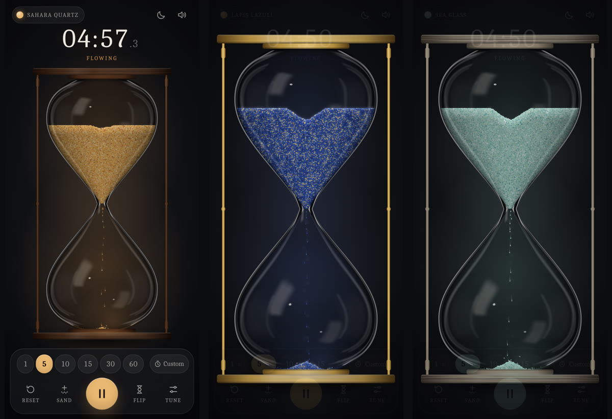
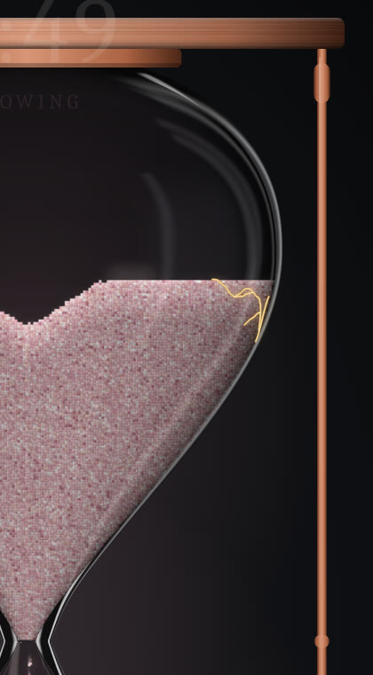

# Hourglass

*A calm sand timer you can hold.* Every grain is simulated and every sound is
synthesised as you listen. Turn the glass, flick it into a spin, tilt or shake
your phone, and the sand answers. Shake it very hard and the glass cracks;
hold a finger on the crack and it mends with gold.



**[Open Hourglass →](https://elkhanany.github.io/hourglass/)**

It is free, has no ads, accounts or tracking, and works offline. Nothing is
loaded from anywhere else: no libraries, no fonts, no audio files.

## Install it

- **iPhone and iPad (Safari):** open the link, tap **Share**, then **Add to
  Home Screen**. Opened from there it runs full screen and offline. To tilt
  and shake the sand with the phone, turn on **Real motion** in **Tune** and
  allow motion access when asked.
- **Android (Chrome):** open the link and tap **Install app** (or ⋮ →
  **Install app**). The installed app runs full screen; a long press on its
  icon offers 5, 15 and 30 minute glasses.
- **Desktop (Chrome, Edge, Safari):** it runs in the browser; Chrome and Edge
  also offer **Install** in the address bar. A burst of mouse clicks knocks
  on the glass.

## Six sands


Sahara Quartz in walnut, Volcanic Black in brushed brass, Moonstone in
frosted silver, Lapis Lazuli in gold, Rose Quartz in copper and Sea Glass in
driftwood. Tap the name at the top to change it, or choose in **Tune**.

## What it does

- **Keeps exact time.** Presets of 1, 5, 10, 15, 30 and 60 minutes, or any
  time from 10 seconds to 99:59. The last grain leaves the neck at `00:00.0`,
  even if the phone slept in between.
- **Real sand.** About 10,000 to 35,000 grains, each one simulated: piles slump
  at sand's own angle, the stream breathes and wanders, grains bounce off the
  glass.
- **Real sound.** The soft hush of sand landing, made of thousands of tiny
  grains, the first grains ticking on bare glass, a singing bowl at the end,
  and an optional brook or rain behind it, all synthesised, nothing recorded.
- **Zen.** Four seconds after you let it run, the controls fade and the glass
  fills the screen; the end of a glass is quiet and slow.
- **A glass you can hold.** Drag it by the waist, turn it by a bulb, flick it
  into a spin and catch it. The sand feels each move at the true scale of the
  glass.
- **Real motion.** With the switch on, the sand follows how you hold the phone:
  lean it, turn it over, shake it.
- **Break it, mend it.** Very hard shaking, five or six hard flicks in a row,
  or a burst of hard knocks creaks the glass, then cracks it, and sand trickles
  out into a small dune. Hold a finger still on the crack to mend it with gold
  (kintsugi), or press Reset for a new glass.

<p>
  
  &nbsp;
  
</p>

## Using it

| Action | Touch | Keyboard |
| --- | --- | --- |
| Start / pause | Tap the glass, or the round button | `Space` |
| Move the glass | Drag it by its waist | |
| Turn the glass | Drag a bulb round; flick it to spin; touch it to stop. Or **Flip** | `F` |
| Mend a crack | Hold a finger still on the glass | |
| Add sand (extends the timer) | Tap or hold **Sand** | focus + hold `Space` |
| Reset | **Reset** | `R` |
| Duration | Pills `1 5 10 15 30 60` min, **Custom**, or tap the time (10 s to 99:59) | |
| Dim the controls now | Moon icon | |
| Mute | Speaker icon | `M` |
| Material, frame, sound, motion, screen | **Tune** | |

After four seconds of running without a touch the controls fade slowly, over
about three seconds, to 12 % (or disappear entirely with *Full Zen*) as the
glass grows to fill the screen; while they are dimmed the tenths rest. While
they are still visibly fading they answer a tap as usual; once dim, the first
tap only brings them back. Playing with the glass (moving, turning, spinning,
catching or mending it) keeps them dim; only a tap brings them back. The moon
icon starts the same fade at once and, where the browser allows it, goes full
screen. With *Reduce Motion* turned on in the system settings, all of this
happens at once instead.

When the sand runs out while the controls are dimmed, the glass stays still
through the last grains and the bowl, then the controls return slowly. A
touch brings them back at once. The app itself opens by fading up from dark,
with the glass already in its place.

A longer glass holds more sand: about a third full for one minute, half for
five, three quarters for 45.

**Tune** holds the rest:

- **Material**: Sahara Quartz, Volcanic Black, Moonstone, Lapis Lazuli (gold
  flecks, gold caps), Rose Quartz (copper), Sea Glass (driftwood); **Frame** hides the
  caps and posts so only the glass remains.
- **Acoustic character** (six voicings) and volume; **Ambience** (a brook or
  rain behind the sand, with its own level); **Completion bowl**.
- **Keep screen awake** while the sand is flowing, and for 12 s after it runs
  out (Screen Wake Lock API).
- **Real motion**: the sand feels what the phone feels. Lean it and the piles
  slump, lay it on its side and the flow (and the clock) stop, turn it over
  and the other bulb becomes the top. Walk and the falling thread sways;
  shake it and the sand lifts and lands; twist it and the sand sloshes; spin
  it flat on a table and the sand is pushed to both ends. Shaken very hard,
  for several seconds, the glass can crack (it creaks first).
- **Full Zen**, **Haptics**.

The glass also remembers where it was: close or reload the page and a running
timer carries on from the wall clock, a paused one comes back as it was left,
cracks and gold seams included.

### Playing with the glass

The glass is an object you can hold. Take it by its waist and it follows the
finger on a soft tether, lifting off its shadow; let go and it springs home
with a small sway. Take it by a bulb and it turns; flick it and it spins on by
itself, slowing as its sand is flung outward, and settles upright or inverted.
Each half turn swaps the time, as the Flip button does. Flicked hard again
and again (five or six times in a row), the spinning sand presses so hard
into the domes that the glass creaks, then cracks. Knocking works too: a quick
burst of taps or clicks on the glass lands harder and harder, and after a few
seconds of it the glass creaks, then cracks where it is struck (the first tap
of a burst still starts or pauses it; ordinary taps never mark it). Touch it while it
moves and it stops under your finger, and stays where it stopped until the
finger moves it on. The sand feels all of this at the true scale of the glass
on the screen, so a gentle drag barely stirs it and a hard spin pins it to
both ends.

With Real motion on, very vigorous shaking (big, fast swings kept up for about
five seconds) can crack the glass. Four faint creaks and glints come first.
Then a fine silver hairline appears; keep going and a chip opens, and sand
trickles out onto the desk below. Hold a finger still on a cracked glass and
gold flows into the crack and seals it (kintsugi), without stopping the
timer. Reset, or a new duration, gives a fresh glass. Drops, knocks, walking
and anything done with a finger can never crack it, and with *Reduce Motion*
on it cannot crack at all.

## How it works

### `physics.js` — simulation and renderer

- **Hybrid granular model.** Packed and sliding sand lives on a lattice of typed
  arrays (one cell = one grain). Grains that leave the neck, are poured in, or
  splash become ballistic particles with sub-pixel position and velocity
  (`v = v0 + g·Δt`), and return to the lattice when they come to rest.
- **Stick and slip.** Sand does not creep, it lets go. A static grain holds
  until the slope over four columns passes 3:4 (37°, the angle of maximum
  stability); once moving it keeps running on slopes down to 1:2 and wakes its
  neighbours, so the surface gives way in small avalanches and builds again.
  Landed grains tumble downslope in short hops while the surface is steeper
  than 3:4. Measured in the test harness the slope breathes between about 32°
  and 36° and averages 33° to 34°.
- **A living stream.** The flow rate swings by tens of percent around its mean
  (slow breathing, pulses near 2 Hz, fine flutter) and the stream leaves the
  neck as one thin thread that wanders. The swings average to zero and fade
  out before the end, so timing is unaffected.
- **Drain funnel.** Voids rise from the neck and diffuse sideways, so the upper
  surface dips in the middle instead of sinking flat.
- **Exact timing.** The wall clock (`Date.now()`) is the master. For any
  remaining time the app knows how many grains must still be above the neck,
  and the neck releases exactly the difference on each fixed 120 Hz step. The
  flow therefore self-corrects after dropped frames, and the last grain leaves
  the neck on the frame the readout reaches `00:00.0`. The final grains thin
  out into single drops. If the page was asleep, the sand that should have
  fallen is laid down at once when it returns (grains still in the air land
  first), and the stream carries on as its usual thin thread.
- **Turning and gravity.** Gravity is a vector. While the glass turns (by the
  button, by hand, or because the device itself is turned) it rotates
  continuously in the vessel's frame, so the sand tumbles along the glass.
  Past 180° the lattice is re-indexed (the vessel is exactly point-symmetric)
  and elapsed and remaining time swap.
- **Sleep map.** Only rows near something that changed are swept, so a settled
  pile costs almost nothing during long timers.
- **Sand rendering.** Each grain is a lit 2×2 bead with a persistent colour
  seed, depth-based ambient occlusion, a rim-lit surface, glossy facets and
  mica glints, written straight into an `ImageData` buffer. A half-resolution
  bloom layer adds the light scattered around the brightest grains.
- **Glass rendering.** The vessel is a surface of revolution, so every pixel
  has an exact 3-D normal. A WebGL fragment shader lights it like a renderer
  would: Fresnel reflection of a small studio (softbox, strip, kickers, a
  pair of rim strips almost straight behind that draw a fine bright line
  along the glass's own edge, one hard lamp), the mirrored second highlight
  of the far wall behind the sand, absorption along the true path through the
  shell, light bent through the solid rim, and the inner surface turning
  mirror-like at a glance, so the sand darkens softly where it meets the
  glass. The room stays put while the glass turns, so highlights slide across
  it. Without WebGL the app falls back to a drawn glass on 2-D canvas.
- **Sand stays inside the glass.** The lattice only knows whole cells, so
  grains, motion streaks and the glow are all clipped at half-cell resolution
  to the same smooth inner surface the glass is drawn with.

Grain counts depend on the duration: on phones from about 10,000 (one minute)
to 21,000 (45 minutes), up to 24,000 after adding sand; roughly 45 % more on
larger screens.

### Motion

- **The felt field, at true size.** The sand feels gravity plus whatever the
  glass is doing: the phone's own acceleration and the glass being dragged
  on screen, turned into the glass's frame, and, while it turns, the
  centrifugal, Euler and Coriolis forces. Every effect enters at the strength
  it would have on a real glass of the size this one appears on screen (1 CSS
  px is about 0.16 mm on an iPhone), so the thresholds are real ones: the bed
  lifts off at 1 g, and sand pins to the far ends once ω²r passes g. Each bulb
  feels the field at the centre of its own sand; a grain in the air feels it
  where it is.
- **At rest, nothing changed.** While nothing moves the glass and its sand is
  cool and settled, each physics step is exactly the step the hourglass always
  took, grain for grain (checked against the version before motion over
  20,000 steps).
- **The bed flies as one body.** Shaken harder than gravity, a packed bed does
  not dissolve into loose grains: it lifts off its seat as one body, flies,
  and lands with a thump (a completely inelastic bouncing bed, after Mehta and
  Luck). A column that meets the far glass stops there with a clack, so the
  bed deforms against the dome but never shreds. Flight heights match a
  one-dimensional bouncing-bed model within about 1 %. Landings raise a little
  spray that patters on the glass.
- **Shaken sand runs.** Each bulb has a granular temperature, driven by how
  much its field changes (a steady lean does not count) and by every landing.
  Hot sand loses its friction and flows faster, so a shaken heap flattens
  toward its dynamic slope and freezes flat when the shaking stops. The
  hottest surfaces throw off a few hopping grains.
- **The neck under shaking.** The neck only lets sand through while the upper
  bed sits on it and the field presses sand into it, so the stream stutters
  with each blow of the hand, and a sideways shake bends the thread. Grains in
  flight bounce off the closed neck like glass. The valve stays the only way
  between the bulbs, so both bulbs' counts stay exact.

### Glass and fracture

- **Every glass has its own flaws.** The glass keeps its own record of damage,
  separate from the sand. Its inner wall is divided into 160 short stretches
  (two bulbs, two sides, forty bands from the waist to the far end), and each
  new glass draws its own flaw strengths: a Weibull spread (modulus 20) that
  makes most of it about equally strong and a few places weaker. The flaws
  come from a seed of their own, so a cracked glass comes back as the same
  glass after a reload, and drawing them never disturbs the sand.
- **Stress corrosion with a fatigue limit.** Each column of sand that slams
  into the glass sends a pulse whose stress grows with its impact speed. Below
  a fatigue limit, about 78 % of the glass's strength, a crack does not grow
  at all, which is why firm or even vigorous shaking never cracks it however
  long it lasts. Above it, damage grows as the 16th power of the stress, as
  stress corrosion does in soda-lime glass. A very hard sideways shake also
  bends the waist like a beam. So a crack starts where the load and the
  weakness meet: the lower dome under vertical shaking, the funnel shoulder
  under slams, the waist under lateral shaking.
- **Warnings first.** A crack can only run so fast, so damage builds at a
  bounded rate and a single blow does at most 15 % of a crack; damage also
  fades while no crack has formed. Four faint creaks, each with a pinpoint
  glint at the stressed spot, come at 35, 60, 80 and 92 % of the way, the
  first at least two seconds before any crack.
- **What cracks it.** In the calibration runs only big, fast swings kept up
  for about five seconds cracked the glass (for example swinging the phone
  ±8 cm four times a second). Drops, knocks, walking, running, twisting and
  finger play never come close. Only real phone motion can arm the damage
  (see Sensors), and with Reduce Motion the glass cannot crack.
- **Crack, chip, leak.** A crack grows as damage goes on, faster the longer it
  gets. Past 26 cells it breaks through and a chip opens, and the chip can
  widen to three cells. A glass holds at most three cracks, never within a
  few rows of the neck, so the two bulbs are never joined. The holes stay
  glass in the lattice (a separate hole map carries the leak), so counting,
  drawing and resetting never see them. The leak is 2-D Beverloo flow with
  jamming, like a small hole in a bin of sand: one grain wide it arches over
  and holds at rest, two wide it trickles about one to three grains a second,
  three wide up to about ten, and shaking breaks the arches. A hole facing
  down leaks freely, one facing up hardly at all, and a grain in flight that
  meets a hole leaves with its own speed. Turning the glass over carries
  every crack and hole with it, so a leak keeps coming from the same place.
- **Kintsugi.** Mending closes every open breach at once (the leak stops
  within a step) and draws the cracks in gold; the mended seam is half as
  strong again. Reset, or a new duration, gives a new glass. The damage is
  saved with the running session in a few hundred bytes.

### Cracks and spilled sand on screen

- **A hairline that catches the light.** A crack is drawn on the glass's front
  layer, after the glass and before the caps: the caps cover its ends under
  the collars, it turns with the glass, and it survives a change of material,
  frame or layout. It grows across the front of the glass along the curved
  surface and is then projected into the picture, so a crack round the
  shoulder by the waist reads as an arc, one on the dome spreads as a star of
  three to five arms, and one in between runs toward the widest part and
  wanders. Each arm draws from its own random seed, so a growing crack only
  ever lengthens and never rearranges itself, and after a flip the same crack
  is simply mirrored back onto the same place. It is a fine silver hairline
  over a soft shadow; every short stretch of it is as bright as it faces the
  room's key light, and the room stays put, so the crack sparkles as the
  glass turns. A breach is a small dark chip where the glass's bright edge is
  broken, with a bright inner rim. No shards, no red.
- **Small moments.** Each creak glints at the stressed spot, a new crack
  flashes once, and a breach brightens its rim for a moment; with Reduce
  Motion there are no flashes. While a finger mends it, gold runs out from
  where the crack began, along every arm at the same pace, and a mended crack
  stays gold, with a light core and a soft glow.
- **Cheap to draw.** The layer is redrawn only when something has changed,
  never more than 30 times a second while the glass turns, and a glass holds
  at most 512 crack segments. A whole glass costs nothing.
- **Spilled sand.** Grains that escape fall in the room, not with the glass:
  their layer sits outside the moving, turning glass, so the sand stays on the
  desk when the glass is lifted or spun, and it grows and shrinks with the Zen
  view like the shadow. They fall under the same slow-motion gravity as the
  sand inside and gather into a small dune on the desk line, made of 2 px
  columns that give way at the angle of repose (33°), measured against the
  real direction of gravity. Lean the phone and the dune creeps downhill and
  pours off the low end of the desk; turn it over and the sand falls away;
  shake it hard and a few grains hop. It is drawn grain by grain in the sand's
  own colours, lit on top and darker below; only the columns that changed are
  redrawn, and its canvas exists only after the first grain has escaped.
  Reset sweeps it away, and it is not kept across reloads.

### Timer under motion

The wall clock stays the master. Moving, shaking, catching and mending never
stop the clock; only a turn (by hand, by a spin or by the Flip button) and
laying the phone on its side do. A shaken neck falls behind, so while shaking
is recent a backlog drains as a slightly thicker thread instead of a clump,
and the page's sleep catch-up never teleports sand. Once the glass is calm
again, the rest of the run is re-timed so the sand that is there lasts
exactly the time that is left: the last grain still leaves at `00:00.0`. Sand
leaking from the upper bulb thins the stream (the neck lets through less), and
where it leaks faster than the stream can make up, as in a long glass, the
rest of the run is re-timed the same way; sand leaking from the lower bulb
never touches the time.

### Sensors: `motion.js`

With Real motion on, the app reads two sensor events: `devicemotion` (the
phone's acceleration and rotation rate, about 60 times a second on an iPhone)
and `deviceorientation` (how the phone is held). `motion.js` turns them into
what the sand would feel: the phone's acceleration with its sign turned round
(−a/g) in the plane of the page; the part out of that plane, which only stirs
the sand; how fast the phone turns in its own plane (from the heading); and
how fast it spins lying flat on a table (from the size of the rotation rate,
which needs no axis order).

Browsers disagree about these sensors: WebKit reports both acceleration
vectors negated, and a few browsers report them in g rather than m/s². So
nothing is taken on trust. While the phone is held still, the accelerometer
is compared with `deviceorientation`, which every engine reports the same
way; the units and the sign are learnt in about a third of a second, and the
sign is remembered for the next visit.

A small dead zone (0.06 g) keeps a resting hand from stirring the sand.
Readings are taken one reading behind, so each 120 Hz physics step gets its
own value. If they stop arriving everything fades to zero; they are ignored
while the page is hidden, and after the page has been away, motion fades
back in over about a second.

Nothing breaks the glass by accident: it can only be damaged once a hard
shake keeps its acceleration, averaged over a quarter of a second, above
1.5 g for 0.6 s, which everyday motion never does. On iOS one permission
covers motion and orientation together: both requests go out at once, inside
the tap on the switch.

### `audio.js` — procedural sound

Web Audio API only. The sand is made of nothing but tiny impacts, because
that is what sand sounds like: a fine grain lands in a fraction of a
millisecond, the stream through the neck is almost silent, and what you hear
is what the grains land on.

1. **The sand as it lands**: two beds of micro-impacts, grains on bare glass
   and grains on sand, synthesised once from a few dozen single clicks:
   band-passed bursts of 0.1 to 0.5 ms between 2.5 and 11.5 kHz, some with a
   neighbour nudged a moment later and a faint low give of the pile; on glass,
   a hard click and one or two of the bulb's own short, high modes. Each bed
   holds two populations drawn from one stream, a dense **hush** and a sparser
   **crackle** (about 600 grains a second). On sand the hush is fine and
   steady, as fine sand is: about 6,500 grains a second, airy, close to a
   smooth hiss, its rate swinging only a little. The crackle over it is the
   few louder grains, and comes and goes over tens of milliseconds and a few
   tenths of a second. On bare glass both are sparser: the first grains are
   few, and each is heard. The mix of grain sizes drifts, and every grain has
   its own loudness (log-normal: a few are bigger), pitch and place in a
   narrow cone in front, the far ear hearing it a few samples late. The sound crossfades from
   glass to sand as the cushion grows. The hush follows the flow and swells a
   little with its breathing, the crackle follows the impacts, and shaking
   lifts the crackle into a soft shaker shimmer.
2. **No loops**: each bed plays as an endless chain of 0.45 to 1.4 s segments
   from random places in it, each at a slightly different speed and level,
   crossfaded with equal power, so the texture never comes round the same way
   (its waveform self-similarity at any lag from 1 to 12 s stays at 0.01 to
   0.05; the old looped hiss read 0.6 to 0.9). While the page is hidden the chain hands over
   to a plain loop of the bed, which needs no script to go on.
3. **Grains you can tell apart**: the physics' impact events play single
   grains, a dry crackle of one to three contacts on sand, a crisp click with a
   short glassy ring on bare glass, each with its own log-normal loudness, now
   and then a rebound, and its own place in front of you (where they land
   wanders slowly). A slow glass is heard grain by grain; a fast one keeps
   fewer, softer ones and lets the hush carry the rest. As the last grains
   fall the hush and the crackle fade with them, and the final few land one by
   one before the bowl.
4. **The vessel**: a broad, low-Q body under the sand, whose lowest mode (the
   air in the bulb) rises as it fills, and the glass's own six resonators
   (680 Hz to 7.25 kHz). In the default character the sand never rings those:
   only the glass in the hand does (a tap, a creak, a crack, a clack).
5. **Foley**: a pour (the beds again, through a band that wanders on two
   random flutters, never a clock), the slide of sand as the glass turns, the
   air it cuts as it spins, flip thuds, a small avalanche down the pile every
   few seconds (a soft swell to one side), and a singing-bowl bloom at the end
   (optional).
6. **The glass in the hand**: shaking is heard as it happens in the physics.
   Each time a bed lifts and lands there is a soft low thump with a little
   grain in it, and the vessel answers; sand slamming the far end clacks,
   glassier; while the sand is agitated the grain textures rise into a soft
   shaker shimmer, and the sliding rush moves between the ears with the
   slosh. A finger stopping a spinning glass makes a soft felt stop. Before a
   crack the glass creaks: up to four tiny high ticks, like a cooling glass.
   The crack itself is a bright snap, the whole vessel ringing, a faint knock
   and a few settling ticks, about 15 dB under the completion bowl; a growing
   crack clicks like ice settling, and a chip opening tinks and rattles.
   Afterwards the vessel's resonances ring 3 % lower and die away sooner, as
   a cracked glass does; mended with gold they are nearly whole again. Grains
   escaping through a chip patter at the leak's rate, finer and higher,
   panned to the chip, and grains landing on the desk are very quiet and dry.
   While a finger holds a cracked glass still, the glass hums under it, and a
   small bell an octave above the bowl marks the mend. Each of these sounds
   plays only for something physical and limits its own rate.

Output passes through a generated 0.35 s room impulse response, a compressor and
a soft clipper.

Six characters re-voice the same grains. *Close-Miked ASMR*, the default, is
the sand alone, close and dry. *Warm Glass* is a thicker, softer glass that
the grains ring gently, with more room and a darker tone; *Pure Sand Whisper*
is mostly the hush. Three more change the vessel itself, by retuning the
resonator bank, letting the sand ring it, and changing the pitch of every
grain:

- *Singing Glass*: resonators tuned to a D major pentatonic with long rings, so
  every grain strikes a small bell.
- *Bamboo Rainstick*: broad, quickly damped woody resonances and lower-pitched
  grains.
- *Desert Dune*: low resonances (150 Hz upward) driven hard by the hush, for
  the hum of sliding sand. Much of it sits below what a phone speaker
  reproduces; it is meant for headphones.

An optional **ambience** plays behind the sand while it runs, bypassing the
character's tone shaping. It keeps flowing through the last grain, then
recedes under the bowl.

- *Brook*: running water, built from the air it traps. Each bubble rings at a
  pitch set by its size (Minnaert) and dies within milliseconds: about 280 a
  second of tiny ones (the fizz above 2.4 kHz), 170 middling ones (the
  babble) and a dozen big, low ones, over the flickering rush of the current.
  Its spectrum, burstiness, tonality, flicker and stereo image were matched
  band by band to six field recordings of small streams; it lands inside the
  range of 53 to 54 of the 54 measures, where the previous brook missed 34.
  Both ears hear the same bubbles, panned and slightly delayed. The flow loops
  every 9.3 s and the big bubbles every 14.3 s, so the two only line up again
  after about 22 minutes.
- *Rain*: a dense patter of fine filtered clicks, a few heavier drops and a
  distant hiss.

Both are synthesised into seamless loops in short steps, one per slice of
main-thread time (each a few to a few tens of milliseconds, so the sand keeps
falling smoothly): the saved one while the page settles after loading, another
the first time it is chosen.

The sand was built against recordings of falling sand and grit (a continuous
pour of fine sand, fine sugar poured close to the microphone, a rainstick,
grit and stone trickles, grains on glass) and against the stream the app's
physics actually feeds it, by rendering offline through the real output chain
and measuring: the spectrum, how grainy and how fluttery it is, how its
colour flickers, how its grains are spaced and how loud they are, its stereo
image, and that nothing repeats or rings. The default character is voiced
toward the fine, steady recordings rather than the coarse trickles, because
the stream of an hourglass is fine and steady. In graininess it sits just
above them (kurtosis 5.6, against 3.4 to 3.6 for the fine pour and the
rainstick, 40 and more for the grit trickles, and 4.0 for the looped hiss it
replaces), its flutter is close to theirs, and it is brighter and airier
than the old hiss without being as bright as they are. Nothing repeats and
nothing rings: no resonance stands more than about 1 dB out of the spectrum
(the old hiss had peaks of 6 dB). The material is the same on every load (it
was calibrated); only how it is played is random. It takes about 200 ms of
synthesis on a desktop, done in slices of a few milliseconds while the page is
idle.

Levels were set the same way: the sand keeps the loudness it had, within
about 1 dB at the default volume (near −32 dBFS RMS for a 30-minute glass,
−29 for a 5-minute one and −27 for a one-minute one), so the bowl and the
ambiences keep their balance; being made of grains rather than hiss, its
peaks stand a little taller, near −8 to −9 dBFS. The brook and rain sit near
−26 and −28 dBFS at their default level. The five other characters were
levelled against the old ones, layer by layer, and the ambiences have not been
tuned by ear (the brook was matched to measurements, not by listening), so
treat the tables at the top of `audio.js` (`CHARACTERS`, `BEDS`, the `MODES_*`
sets, `WATER`, `AMBIENCES`, `LEVEL`) as a starting point.

### `app.js`, `index.html`, `styles.css`

Timer state, controls, Zen HUD, settings and the running session (stored in
`localStorage`, with the glass's damage), the glass as a body (springs for the
finger, home and the detent, a coasting spin that conserves angular momentum
as the sand moves, and a catch that stops the glass where the finger meets
it), the felt field composed for every physics step, re-timing, the Real
motion permission, screen wake lock, a frame-time governor that lightens the
physics on slow phones, and service-worker registration. The clock uses
`Date.now()` so it keeps counting while a phone sleeps. A hidden
`?debug=motion` overlay shows the sensors and the sand's state, and `&rec=N`
records N seconds of raw sensor events to a file, for tuning on a device.

### `sw.js`, `manifest.json`

Offline-first, stale-while-revalidate cache of the app shell. Every path is
relative (`./`), including `start_url` and `scope`, so the app works from a
sub-directory such as `/hourglass/`.

## Project structure

```
index.html  styles.css      the page and its look (one screen, two sheets)
app.js                      the controller: clock, gestures, Zen, settings, sessions
physics.js                  the sand simulation, the glass, cracks and spilled sand
audio.js                    the procedural sound engine
motion.js                   the phone's motion sensors
sw.js  manifest.json        offline cache and install metadata
icons/                      app icons and iPhone launch screens (icons/splash)
docs/images/                the pictures in this README and the install screenshots
tools/icons.html            regenerates the icons from one SVG
tools/test/                 development-only tests (not part of the app)
```

The app is plain files with no build step: whatever is in the repository is
what the browser runs.

## Deploying to GitHub Pages

1. Merge to `main`.
2. Repository **Settings → Pages → Build and deployment**: *Deploy from a
   branch*, branch `main`, folder `/ (root)`.
3. Open `https://<user>.github.io/hourglass/`.

The empty `.nojekyll` file in the repository root tells Pages to serve the files
as they are, without running Jekyll.

When you change any shipped file, bump `VERSION` in `sw.js` so installed copies
drop the old cache. An installed app picks up a new version on its second
launch after the change (the first launch fetches it in the background).

## Running locally

Any static file server works. The page must be served over `http://localhost`
or HTTPS for the service worker to register.

```bash
npm start                      # or: python3 -m http.server 8000
```

Then open `http://localhost:8000/`.

## Tests

Development-only tests live in `tools/test` and are not part of the app (the
service worker does not cache them). They need Node 22 and Playwright with
Chromium:

```bash
npm install && npx playwright install chromium
npm test                       # every suite, one line each (about 15 minutes)
npm run test:physics           # the simulation only, in Node (about 3 minutes)
node tools/test/app-gestures.test.js     # any single suite
```

- `sim-*`: the simulation, in Node. `sim-identity` runs it side by side with
  the version before motion (f446085, read from git) and checks that, with
  nothing moving, every grain lands exactly as before. The others cover
  cracks, leaks, mending and saving (`p0`), conservation, sanity, flight,
  fracture, spinning, knocking, leak, flip, persistence, determinism, the
  valve, the clock and performance.
- `render-*`: the crack paths, their redraw and the spilled sand's physics in
  Node; cracks, their glint, kintsugi and the spill in the real app; and,
  with no cracks, the picture against f446085, pixel for pixel.
- `motion-*` and `audio-*`: the sensor pipeline (against a model of a phone
  being shaken, in each browser's sign convention) and its permission, and
  the sound engine's calls and levels.
- `app-*`: the app's own acceptance tests (permission, gestures, motion,
  re-timing, session, the existing flow), with stand-ins for any module that
  is missing.
- `e2e-*`: the integration scenarios on the real modules: calm (E1, E11),
  motion (E2, E3, E14), timer (E4, E5), gestures (E6–E8), session (E9, E10),
  permission (E12) and performance (E13).

Each prints one line per check and exits non-zero on a failure. The browser
tests serve the app themselves: `app-*` and `e2e-*` take `--port <n>` (default
8804) and `--root <dir>` to test another checkout, the `render-*`, `audio-*`
and `motion-permission` tests take the port as their first argument, and all
of them read `PORT`. Shared helpers live in `tools/test/lib`: the app's clock,
the hand and phone motion profiles with a device-event synthesiser for both
accelerometer sign conventions, and a zero-dependency static server
(`node tools/test/lib/static-server.js <port> [root]`).

Without a GPU, Chromium shades the WebGL glass in software and every frame of
a turn takes most of a second, so the app and integration tests use the
app's own 2-D glass unless given `--webgl`. For the same reason the frame-time
budgets are best judged on a device: there the canvases are handed to the
GPU to composite, while here the main thread copies them in software and
another thread composites them. `e2e-perf` with `--trace` notes how each
stretch was spent, telling the app's own work from that.

## Icons and launch screens

`icons/` holds the SVG source and the PNG sizes the manifest and iOS need.
`tools/icons.html` regenerates all of them in the browser from one SVG
template; it is not part of the installed app. `icons/splash/` holds dark
launch screens for current iPhone sizes, so an app opened from the home screen
never flashes white before its first frame.

## Browser notes

- iOS Safari only starts audio from a user gesture. The app creates and resumes
  the audio context on the first touch, and resumes it again after an
  interruption (call, lock screen, tab switch).
- Real motion needs motion permission on iOS 13+; the switch asks for it, once
  for both sensors. If the browser asks again after a reload, the switch stays
  on and the next tap on the screen asks (where the site was already allowed,
  that answer comes back without a prompt).
- Keep screen awake needs the Screen Wake Lock API: Safari 16.4+ on iOS, and
  iOS 18.4+ when installed to the home screen.
- A web app cannot hide the iPhone status bar or silence notifications. On
  Android the installed app runs full screen; in desktop and Android browsers
  the moon icon enters full screen.
- Haptics use `navigator.vibrate` on Android. iOS has no vibration API; on
  iOS 18 and later a hidden switch control is flipped instead, which taps the
  Taptic Engine lightly. iOS allows that only as a finger lifts or taps, so
  a tap wanted while the finger is down (a catch, a half turn) plays as it
  lifts; timers and shaking cannot tap at all.
- The completion sound can only play in a hidden tab if the browser keeps the
  page's audio running; on a locked phone it generally will not.

## License

GPL-3.0. See `LICENSE`.
