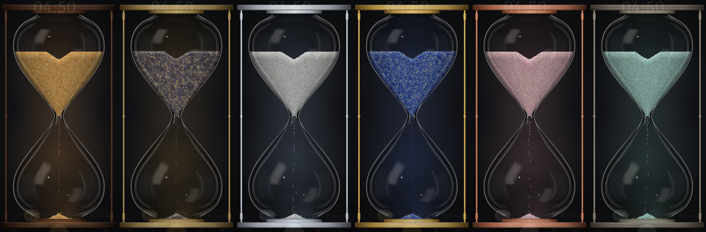

# Hourglass

*A calm sand timer you can hold.* Every grain is simulated and every sound is
synthesised as you listen. Turn the glass, flick it into a spin, tilt or shake
your phone, and the sand answers. With the classic sand the glass can break:
drop it, knock on it, spin it hard or shake the phone hard and it creaks, then
cracks; hold a finger on the crack and it mends with gold.

**[Open Hourglass →](https://elkhanany.github.io/hourglass/)**

It is free, has no ads, accounts or tracking, and works offline. Nothing is
loaded from anywhere else: no libraries, no fonts, no audio files.

## Install it

- **iPhone and iPad (Safari):** open the link, tap **Share**, then **Add to
  Home Screen**. Opened from there it runs full screen and offline. To tilt
  and shake the sand with the phone, turn on **Real motion** in **Tune** and
  allow motion access when asked.
- **Android (Chrome):** open the link and tap **Install app** (or ⋮ →
  **Install app**). The installed app runs full screen; a long press on its
  icon offers 5, 15 and 30 minute glasses.
- **Desktop (Chrome, Edge, Safari):** it runs in the browser; Chrome and Edge
  also offer **Install** in the address bar. A burst of mouse clicks knocks
  on the glass (classic sand).

## The sands

Sahara Quartz in walnut, Volcanic Black in brushed brass, Moonstone in
frosted silver, Lapis Lazuli in gold, Rose Quartz in copper and Sea Glass in
driftwood. Since 1.14.0 the sand and the frame are chosen apart: three more
sands (Red Garnet, Olivine and Amethyst), a sand made from any colour you
pick, and the frame's finish (walnut, brass, silver, gold, copper or
driftwood) in Tune's Glass tab. Tap the name at the top to change the sand,
or choose in **Tune**. With
**Layered sand** on, each has a companion tone: Sahara's gold with a deeper
sienna, Volcanic Black with pumice grey, Moonstone with its blue shadow, Lapis
Lazuli with seams of old gold, Rose Quartz with a dustier rose, Sea Glass with
deep-water teal.

## What it does

- **Keeps exact time.** Presets of 1, 5, 10, 15, 30 and 60 minutes, or any
  time from 10 seconds to 99:59. The last grain leaves the neck at `00:00.0`,
  even if the phone slept in between.
- **Work and rest.** A custom time can be followed by a rest, and the pair
  repeated: 25 minutes, then 5, four times. When a glass runs out a soft bowl
  sounds, the glass turns itself over, and the same sand runs the rest.
- **Real sand.** About 10,000 to 35,000 grains, each one simulated: piles slump
  at sand's own angle, the stream breathes and wanders, grains bounce off the
  glass.
- **Layered sand.** Turn it on in **Tune** and each sand gains a companion
  tone. A new glass is filled in a pattern of its own: bands fine or bold,
  level or leaning, arched, waved or folded. As it runs, the two tones settle
  into strata on the heap below, and every turn of the glass lets the sand
  settle into a new pattern. No two are alike.
- **Finer sand** (classic sand). Choose the grain in **Tune**: Classic, Fine (twice the
  grains) or Finest (four times, about 40,000 for a one-minute glass on a
  phone). The finer sand flows, slumps, sounds and keeps time as the classic
  sand does; there is simply more of it, each grain smaller, and more work
  for the phone.
- **Real sand on the graphics chip** (Tune, on by default from 1.10.0). The
  sand of the sand lab: every grain a point of a continuum simulated on the
  phone's graphics chip, in the same glass, keeping the same exact time. It
  needs WebGPU (iOS 26 or later); where that is missing its note says so and
  the classic sand runs, as it always has, and it tries again after an iOS
  update or a tap on the switch. While it runs the glass does not crack and
  **Grain** is hidden: turn Real sand off in **Tune** for the classic sand,
  its finer grains and a glass you can break and mend.
- **Real sound.** The soft hush of sand landing, made of thousands of tiny
  grains, the first grains ticking on bare glass, a singing bowl at the end,
  and optional water behind it (a brook, rain, the ocean, a waterfall, or
  drips in a grotto), all synthesised, nothing recorded.
- **Zen.** Spread two fingers on the screen, or tap the moon, and the controls
  fade while the glass grows to fill the screen. Pinch them together to come
  back. Nothing else changes the view: not a tap, not playing with the glass,
  not time.
- **Breathing pace.** If you like, the glow behind the glass swells as you
  breathe in and fades as you breathe out, for as long as the sand runs.
- **A glass you can hold.** Drag it by the waist, turn it by a bulb, flick it
  into a spin and catch it. The sand feels each move at the true scale of the
  glass.
- **Real motion.** With the switch on, the sand follows how you hold the phone:
  lean it, turn it over, shake it.
- **Break it, mend it** (classic sand). The glass stands on a desk and can be picked up,
  dropped, thrown and banged down. A hard landing, eight quick knocks, three
  or four hard flicks or a few seconds of hard shaking creak the glass, then
  crack it, and sand trickles out into a small dune. Hold a finger still on
  the crack to mend it with gold (kintsugi), or press Reset for a new glass.

  
  &nbsp;
  

  

  

## Using it

| Action | Touch | Keyboard |
| --- | --- | --- |
| Start / pause | Tap the glass, or the round button | `Space` |
| Move the glass | Drag it by its waist | |
| Turn the glass | Drag a bulb round; flick it to spin; touch it to stop. Or **Flip** | `F` |
| Mend a crack | Hold a finger still on the glass | |
| Add sand (extends the timer) | Tap or hold **Sand** | focus + hold `Space` |
| Reset: the old sand is drawn into the neck, new sand is poured in | **Reset** | `R` |
| Duration | Pills `1 5 10 15 30 60` min, **Custom**, or tap the time (10 s to 99:59) | |
| Work and rest | **Custom** (or tap the time): *Then rest* 1 to 60 min, *Rounds* 1 to 12 | |
| Zen: the glass fills the screen | Spread two fingers, or the moon icon | |
| Back from Zen | Pinch two fingers together | `Esc` |
| Mute | Speaker icon | `M` |
| Sand, glass, sound and time: sand, frame and its finish, ambience, motion, breathing, screen | **Tune** (four tabs) | arrow keys between the tabs |

## Documents

- [Using Hourglass](docs/guide.md): the guide. Zen, the amount of sand,
  everything in **Tune**, work and rest, playing with the glass, breaking it,
  Real sand, and what each browser allows.
- [How it works](docs/engines.md): the sand, the glass, motion, cracks, the
  timer, the sensors, the sound, and Real sand on the graphics chip; what a
  sand engine must provide, and how to add a sand, a shape, a sound or a
  setting.
- [Architecture](docs/architecture.md): the files, the offline cache,
  running and deploying it, the release checklist, the standing decisions.
- [Tests](docs/testing.md): every suite, how to run them, and the sand lab.
- [Real sand: the design](docs/design/real-sand.md): the GPU sand in the app,
  section by section.
- [Settings: the design](docs/design/settings.md): the settings' steps as
  they are built, starting with Real sand as the default.

## License

GPL-3.0-or-later. See `LICENSE`. Where a file's header says GPL-3.0, it
means this licence: version 3 or, at your option, any later version. The GPU
sand's solver keeps the MIT and BSD-3-Clause notices of the work it is
derived from (`realsand/LICENSES.md`).
